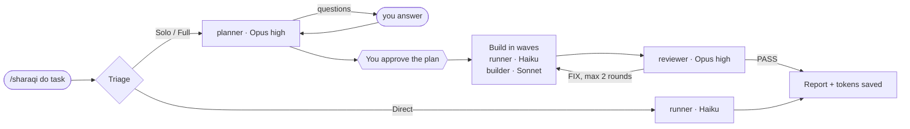

# 🎼 sharaqi — the conductor

**One command. The right model for every step. A receipt for the tokens you saved.**

```
/sharaqi do build a calculator app with a history panel
```

sharaqi is a Claude Code skill that works like a conductor. Opus thinks: it asks what matters, writes the PRD, the plan and a task card for every piece of work. Cheaper models play: each card goes to the cheapest agent that can do it, Haiku or Sonnet, with the effort level set per card. Then Opus reviews the result, writes fix cards, and hands them back to a cheap model. At the end you get a report: what was done, who did what, and how much it cost compared with running everything on Opus.

Nothing ever runs above **Opus 5.5 at `high` effort**. A hook enforces it.

[](./LICENSE)

---

## Installation (1-minute setup)

### 1. Get the skill

<details open>
<summary><strong>Option A — git clone</strong> (recommended, gives you <code>/sharaqi</code>)</summary>

The folder **must** be named `sharaqi` inside your skills folder. That is what makes the command `/sharaqi` with no prefix.

**macOS / Linux**

```bash
git clone https://github.com/EngSharaqi/sharaqi-workflow.git ~/.claude/skills/sharaqi
```

**Windows (PowerShell)**

```powershell
git clone https://github.com/EngSharaqi/sharaqi-workflow.git "$env:USERPROFILE\.claude\skills\sharaqi"
```

Update later with `git pull` inside that folder.

</details>

<details>
<summary><strong>Option B — plugin marketplace</strong> (gives you <code>/sharaqi:sharaqi</code>)</summary>

Inside Claude Code:

```
/plugin marketplace add EngSharaqi/sharaqi-workflow
/plugin install sharaqi@sharaqi-workflow
```

Or from your terminal:

```bash
claude plugin marketplace add EngSharaqi/sharaqi-workflow
claude plugin install sharaqi@sharaqi-workflow
```

Plugins are namespaced, so the command becomes `/sharaqi:sharaqi do <task>`. Everything else in this README is the same. Update with `claude plugin marketplace update sharaqi-workflow`.

</details>

Then start a **new** Claude Code session (or run `/reload-plugins`).

**Requirements**

| Need | Why |
|---|---|
| [Claude Code](https://claude.com/claude-code) | runs the skill |
| `git` | install and update |
| `bash` | runs the hooks. Built in on macOS/Linux; on Windows it is Git Bash, which Claude Code already uses |
| Python 3 | the token report. Without it the skill still works, the report is just rougher |

### 2. Run `/sharaqi setup` (once)

It shows your current auto-compact window and asks you to pick a smaller one (200,000 tokens is recommended). A smaller window means every turn re-reads less history. It only changes `autoCompactWindow` in `~/.claude/settings.json`, after you confirm, and applies from the next session.

### 3. You're ready to go

```
/sharaqi do <your task>
```

---

## Commands

| Command | What happens |
|---|---|
| `/sharaqi do <task>` | A full run: understand → plan → approve → build → review → report |
| `/sharaqi resume` | Continue the latest run for this project from where it stopped |
| `/sharaqi status` | Show the current run's phase, cards and last token report |
| `/sharaqi setup` | One time: make Claude Code auto-compact earlier |

`do` is optional: `/sharaqi add dark mode to the settings page` works too.

---

## What a run looks like



1. **Triage.** sharaqi picks the cheapest path that is safe and tells you why in one line:

   | Path | When | What runs |
   |---|---|---|
   | **Direct** | One command or one file, fully stated, no design choice | One cheap agent, straight to the report |
   | **Solo** | One tightly coupled chain of reasoning (a bug where finding the cause *is* the fix) | A short PRD and **one** card for a strong model |
   | **Full** | A feature, several separable parts, or routine bulk work | Everything below |

2. **Plan.** The planner (Opus, `high`) reads the repo and asks you only the questions whose answers change the work, with options and a recommendation. Then it writes:
   - `prd.md` — goal, out of scope, roles, current vs required behaviour with `file:line`, acceptance criteria (Given/When/Then), risks, decisions
   - `plan.md` — waves, routing table, what would leave your machine
   - `cards/T01.md …` — one card per unit of work: exact files, anchors, before/after blocks, a verify command, and when to stop and report instead of guessing

3. **Approve.** You see the cards as a table (id · title · agent · model/effort · depends on) and choose **Go**, **Change something**, or **Stop**.

4. **Build.** Cards run in waves. Cards in the same wave run in parallel when they don't touch the same files. Every agent returns a short report:

   | Report | sharaqi does |
   |---|---|
   | `DONE` | marks the card done |
   | `MISMATCH` | the code doesn't match the card → back to the planner to fix the card. Coders never improvise |
   | `FAILED` | retry once, then one model step up (never above Opus `medium` for coding) |
   | `BLOCKED` | asks you |

5. **Review.** The reviewer (Opus, `high`) checks the diff against every acceptance criterion with `file:line` evidence. If something is wrong it writes **fix cards** (a mini plan) and they go back to a cheap model. At most two fix rounds, then you decide.

6. **Report.** At most 20 lines: what changed and how it was verified, which model did what, and the token bill.

---

## The orchestra

| Agent | Default | Range | Plays |
|---|---|---|---|
| **conductor** (the skill itself) | Sonnet · `medium` | fixed | routes work, talks to you, measures. Never reads source code |
| **planner** | Opus · `high` | fixed | PRD, plan, cards, card amendments |
| **builder** | Sonnet · `medium` | Haiku `low` … Opus `medium` | code cards, executed literally |
| **runner** | Haiku · `low` | Haiku `low`/`medium` | commands and exact-text edits: `npm install`, `git status`, renames, version bumps |
| **reviewer** | Opus · `high` | fixed | review, fix cards |

How the planner routes each card ([`references/routing.md`](./references/routing.md)):

| Card looks like | Goes to |
|---|---|
| Run commands and report (`npm install`, tests, `git diff`) | runner · Haiku `low` |
| Mechanical edit with the exact text given | runner · Haiku `low` |
| Same, across 4+ files or with a check that must not be skipped | runner · Haiku `medium` |
| Boilerplate copied from a named sibling file | builder · Haiku `medium` |
| Standard implementation from a complete card | builder · Sonnet `medium` |
| Long or tricky card | builder · Sonnet `high` |
| Failed twice, or needs a lot of surrounding code | builder · Opus `medium` |

---

## Why this exists

### #1: Tokens run out because every task runs on the biggest model

**The problem.** Most developers leave one model and one effort level on for everything. Running `npm install` or renaming a variable at Opus `high` costs the same per token as designing a feature.

**The fix.** Judgement goes to Opus, typing goes to the cheapest model that can do it. Per million tokens, Opus 5.5 is $4 in / $20 out, Sonnet 5.5 is $2 / $10, and Haiku 5.5 starts at $0.10 / $0.50. Anything that can move to Haiku is an order of magnitude cheaper.

### #2: Cheap models are cheap until they guess

**The problem.** A small model given a vague task makes design decisions on its own. Fixing a wrong guess costs more than the planning would have.

**The fix.** Cards are written so the coder has nothing to decide: exact files, anchors, before/after blocks, a verify command. If reality doesn't match the card, the coder stops and reports `MISMATCH`. This follows Anthropic's guidance for Sonnet in agentic coding: *"start with `medium` for well-specified tasks and move to `high` for harder or longer ones."* A sharaqi card is well specified by construction.

### #3: Orchestration isn't always cheaper

**The problem.** Splitting a task into many agents has overhead. For one tightly coupled chain of reasoning, a single model at lower effort is often cheaper.

**The fix.** Triage. Small, fully stated jobs skip planning (**Direct**). Coupled reasoning gets one strong card (**Solo**). Only real features get the full pipeline. If the pipeline won't pay for itself, it doesn't run.

### #4: Nobody knows if it actually saved anything

**The fix.** Every run ends with a report built from the real session transcript, not from guesses:

```text
| Role      | Model      | Effort | Calls | Tokens    | Output | Cost $ |
|-----------|------------|--------|-------|-----------|--------|--------|
| conductor | sonnet-5-5 | medium |    18 |   412,300 |  9,100 |   0.21 |
| planner   | opus-5-5   | high   |     9 |   188,400 | 14,200 |   0.48 |
| runner    | haiku-5-5  | low    |    12 |   240,800 |  3,900 |   0.01 |
| builder   | sonnet-5-5 | medium |    21 |   655,000 | 22,700 |   0.39 |
| reviewer  | opus-5-5   | high   |     7 |   210,600 |  6,800 |   0.31 |

TOTAL_TOKENS: 1,707,100
ACTUAL_COST_USD: 1.40
ALL_OPUS_COST_USD: 3.12
SAVED_USD: 1.72 (55%)
```

*(Example numbers, to show the format.)* Each run also adds a line to `~/.claude/sharaqi/ledger.csv`, so over a few weeks you can see whether it pays off for your team.

### #5: Long sessions quietly cost the most

**The problem.** Every turn re-reads the whole conversation. A session that runs three tasks pays for the first task three times.

**The fix.** Session hygiene, built in (see below).

---

## Session hygiene: compact and fresh sessions

Claude Code does not let a hook run `/compact` itself, so sharaqi does the next best thing:

- **After a run finishes**, the first plain message you send in the same session is held once, with a reminder to run `/compact` first. Send the message again and it goes through. Slash commands always pass.
- **After the second compaction** in a session, you get a gentle hint (once per new compaction) that a fresh session is cheaper, because compacting costs tokens too.
- **`/sharaqi setup`** lowers `autoCompactWindow`, the only setting that makes Claude Code compact automatically.

The messages are in Egyptian Arabic, because sharaqi was born in an Egyptian team:

| You see | It means |
|---|---|
| 🎼 شراقي: التاسك خلصت. عشان توفّر توكنز اكتب /compact الأول… | The task is done. To save tokens, run /compact first, then send your message again. |
| 🎼 شراقي بيقولك: المحادثة دي اتعملها compact N مرات… | This conversation was compacted N times. A new session is better, since compacting costs tokens too. |

---

## Safety rails

- **Model ceiling.** A `PreToolUse` hook blocks any subagent call that asks for Fable/Mythos or `xhigh`/`max` effort. To lift it for one session: `SHARAQI_ALLOW_ABOVE_CAP=1 claude`.
- **Nothing leaves your machine without a yes.** `git commit`, `git push`, PRs, publishing: cards may prepare them, but they only run after you approve that exact action, every time.
- **Your repo stays clean.** PRDs, plans, cards, reviews and token reports go to `~/.claude/sharaqi/<project>/<date>-<slug>/`, never into the repo. Only the code changes land there, uncommitted, for you to review.

---

## Configuration

| Setting | Default | What it does |
|---|---|---|
| `SHARAQI_HOME` (env) | `~/.claude/sharaqi` | Where run folders and `ledger.csv` live |
| `SHARAQI_ALLOW_ABOVE_CAP=1` (env) | off | Disables the model ceiling for that session |
| `autoCompactWindow` (settings.json) | Claude Code's default | Set by `/sharaqi setup`; change per model later with `/autocompact` |

---

## Tips for the biggest savings

- **One task, one session.** Start each `/sharaqi do` in a new session.
- **Don't run your main session on Fable or `xhigh`.** The ceiling covers subagents; your own session model is your choice.
- **Answer the planner's questions carefully.** Two minutes there saves a fix round.
- **Check the ledger** after a week. If a kind of task never saves, do it by hand.

---

## What's inside

```
SKILL.md                    the conductor (Sonnet, medium)
agents/planner.md           Opus high: PRD, plan, cards
agents/builder.md           Sonnet medium by default: code cards
agents/runner.md            Haiku low: commands and exact-text edits
agents/reviewer.md          Opus high: review and fix cards
references/routing.md       which card goes to which model, and why
references/*-template.md    PRD, plan, card and review templates
hooks/cap-model.sh          the Opus-high ceiling
hooks/session-hints.sh      the compact reminder and the new-session hint
scripts/tokens.py           token report from the real session transcript
.claude-plugin/             plugin and marketplace manifests
```

---

## FAQ

<details>
<summary><strong>How accurate is "saved"?</strong></summary>

It re-prices the exact same requests at Opus 5.5 rates and compares. It's an estimate in both directions: it does not count what lower effort saved, and it does not count the planning you might have skipped if you'd worked alone.

</details>

<details>
<summary><strong>Does it work outside a git repo?</strong></summary>

Yes. Without git, the reviewer can't diff against a base commit, so it reviews the files the cards changed instead.

</details>

<details>
<summary><strong>The command isn't found.</strong></summary>

- Option A: check that the folder is exactly `~/.claude/skills/sharaqi` and contains `SKILL.md` at its root.
- Option B: the command is `/sharaqi:sharaqi`.
- Either way, start a new session after installing.

</details>

<details>
<summary><strong>How do I uninstall?</strong></summary>

- Option A: delete `~/.claude/skills/sharaqi`.
- Option B: `claude plugin uninstall sharaqi@sharaqi-workflow`.

Run history stays in `~/.claude/sharaqi/` until you delete it.

</details>

---

## Inspiration

Inspired by Matt Pocock's [skills](https://github.com/mattpocock/skills): small, composable skills for real engineering. sharaqi adds one idea on top: **spend the expensive model on thinking, not typing.**

## License

[MIT](./LICENSE) © Mohamed A. Sharaqi
