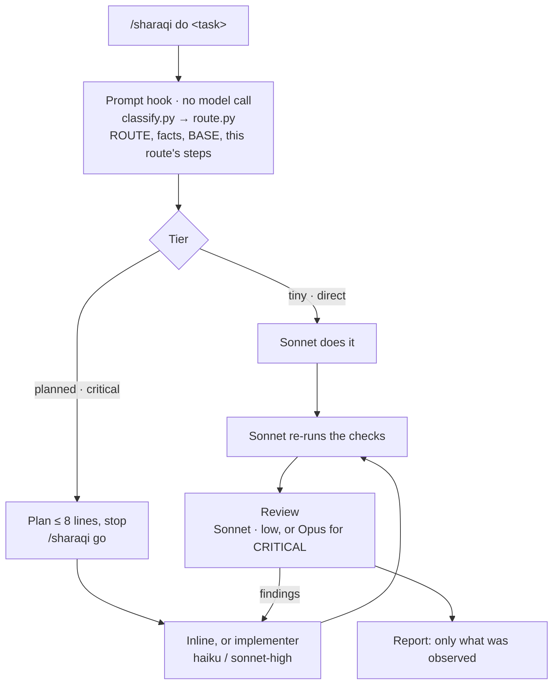

# sharaqi — Opus judgement on a Sonnet bill

**Route every task in a hook, run it on Sonnet, call Opus only when the risk earns it. And get a receipt for every token.**

[](LICENSE)
[](.claude-plugin/plugin.json)
[](.github/workflows/test.yml)

| On the 11-case routing benchmark, against plain Claude Code (Opus · medium) | |
|---|---:|
| 💸 Cost | **−55%** ($0.92 vs $2.04) |
| ⚡ Wall clock | **−36%** (123 s vs 194 s) |
| 🎯 Routes as expected | **11/11** |
| 🔁 Model turns | **14** vs 37 |

<sub>One paid round, 33 runs, 2026-10-28, Claude Code 2.1.312. A routing benchmark: it
measures the decision, not finished tasks. Full numbers and limits:
[benchmarks/v1.0/RESULTS.md](benchmarks/v1.0/RESULTS.md).</sub>

A Claude Code plugin for development tasks. A prompt hook reads your task and routes it
before the model sees it, with no model call. Sonnet runs the session. Haiku and Sonnet
agents take bounded work. Opus comes in only on a logged escalation: a CRITICAL change,
checks failing twice, or judgement a brief can't pin down. The session re-runs the checks
itself, reviews in proportion to the risk, and reports only what it verified.

```
/sharaqi do <task>          # the hook routes it; plan and review follow from the route
/sharaqi route <task>       # print the route only
/sharaqi review [target]    # read-only review of a diff or a document
/sharaqi go [notes]         # approve a waiting plan (a plain "yes" runs on the session's model)
/sharaqi --debug do <task>  # adds ▶/◀ delegation lines and the token receipt
```

As a plugin the command is `/sharaqi:sharaqi …`; the subcommand is the first word of
the arguments.

> [!NOTE]
> **v1.0.0-exp is experimental.** The routing step is measured (above). Finished tasks are
> not yet measured on v1.0: on the earlier task benchmarks (v0.6–v0.7.1, Opus seat) plain
> Claude Code was cheaper. An end-to-end v1.0 task benchmark is the next step. v0.9 stays
> reproducible from commit `a05e49d`.

## What's new in v1.0

| | v0.9 | v1.0 |
|---|---|---|
| Who runs the session | Opus · medium | **Sonnet · medium** |
| Who routes the task | an Opus turn judging facts, then `route.py` | **a prompt hook** (`classify.py` → `route.py`), before any model turn |
| Skill text paid on every turn | 18,487 B | **1,672 B**, plus only the current route's steps |
| Agents | 7 variants | **3**: `implementer`, `reviewer`, `planner`; model and effort set per call |
| Reviewer | Opus on every planned task | **Sonnet · low**; Opus · medium/high only for a CRITICAL trigger |
| Opus | anywhere | **only with `escalate:<reason>`**, blocked otherwise, every call logged |
| Approving a plan | plain "yes" (ran on Opus) | **`/sharaqi go`** keeps the Sonnet seat |
| Delegation lines and token receipt | always printed | **`--debug` only** |
| Run accounting | per benchmark | **`scripts/runrecord.py`**: one JSON record per run |
| Headless runs | context gate blocked every Agent call | benchmark mode declares the window |

Design notes and how each change was verified:
[docs/architecture.md § v1.0](docs/architecture.md#v10-experimental-sonnet-seat-opus-on-escalation).

## Requirements

- **Claude Code** with plugin support. Tested on 2.1.312.
- **bash** on `PATH`: the hooks are bash scripts.
- **Python 3**: the prompt hook routes with it. Without Python the session is told
  `ROUTE UNAVAILABLE` and judges the route itself; the token receipt reads `unavailable`.
- **jq** (optional): the hooks parse their input with jq, else Python, else plain text.

## Quick start

1. Install as a plugin:
   ```bash
   claude plugin marketplace add EngSharaqi/sharaqi-workflow
   claude plugin install sharaqi@sharaqi-workflow
   ```
2. Check it's there: `claude plugin list` should list `sharaqi`.
3. Start a new session in your repo and run a task:
   ```
   /sharaqi:sharaqi do fix the date parsing in the signup form
   ```

Alternative: `git clone https://github.com/EngSharaqi/sharaqi-workflow.git ~/.claude/skills/sharaqi`
gives the command `/sharaqi`. The folder must be named `sharaqi`; Claude Code also loads it
as the plugin `sharaqi@skills-dir`, with the same agents and hooks.

## How it works



1. **Route.** The hook turns the prompt into facts, each marked stated or assumed, and
   `route.py` turns those into a ROUTE line. The session corrects an assumed fact after its
   first reads by re-running `route.py`; a CRITICAL trigger can't be dropped.
2. **Plan.** Planned and critical routes print a short plan and wait for `/sharaqi go`.
3. **Implement.** Inline, or a code-free brief to the `implementer`.
4. **Verify.** The session re-runs the checks itself. An implementer's "done" is a claim.
5. **Review.** By the route's reviewer, against the delta from BASE.
6. **Report.** What changed, which checks ran, the review, risks and unknowns.

## Tiers and reviews

| Tier | When | Plan + approval | Review |
|---|---|---|---|
| tiny | one file, < ~30 lines, no behaviour change, no CRITICAL trigger | none | diff and narrowest check |
| planned | any other code change | plan, wait for `/sharaqi go` | `reviewer · sonnet · low` |
| critical | a CRITICAL trigger, at any size | plan, wait; Opus planner when uncertain | `reviewer · opus · medium`, `high` for security, plus the [security checklist](references/security-checklist.md) |
| direct | non-coding: emails, reports, analysis, test plans | none | none unless `/sharaqi review` |

CRITICAL triggers: auth, permissions, secrets; data migration or deletion; anything
irreversible; real-money side effects; security-sensitive parsing; shared infrastructure
(build, CI, deploy, dependencies). Blast radius, not domain words: fixing cart-total math is
planned; charging a card is critical. A mixed task routes only its code part. Borderline
cases: [references/triage.md](references/triage.md).

## Delegation ladder

| Rung | For |
|---|---|
| inline (Sonnet seat) | small, approach known |
| `R2` implementer · haiku · medium | mechanical work on a pattern the repo already shows |
| `R3` implementer · haiku · high | logic with tests or a typecheck to catch a miss |
| `R4` implementer · sonnet · high | tricky logic, only when wide (≥ 3 files or ≥ 60 lines) |
| `R6` implementer · opus · medium | `escalate=failed-twice` or `escalate=reasoning` |
| planner · opus · high | CRITICAL plans with `--uncertain yes` |

**Ceiling:** never Fable or Mythos; never above high effort. The values live in
[scripts/prices.json](scripts/prices.json).

## Guarantees: enforced vs instruction only

| Rail | Enforced by | Gaps |
|---|---|---|
| Opus only on escalation | `hooks/agent-audit.sh`: an Opus Agent call without `escalate:<critical\|failed-twice\|reasoning>` is blocked; every call is logged | active only during a `/sharaqi` run |
| Foreground agents only | `agent-audit.sh` requires `run_in_background: false` (a background result returns on the session's model) | same |
| Model ceiling; every Agent call names a model | `hooks/cap-model.sh` during a run | without jq or Python it blocks only what it reads clearly |
| Context gate (warn 35%, block 40%) | `hooks/context-gate.sh` on Agent, Edit, Write | fails closed when the window can't be verified; install the statusline bridge (`/sharaqi setup`) |
| Reviewer can't change anything | the agent has only Read, Grep, Glob | none known |
| Session on Sonnet · medium | `model` / `effort` in SKILL.md | the `/sharaqi` turn only: approve with `/sharaqi go`, not "yes" |
| Ask before commit / push / PR | Claude Code permission rules, if you accept them in `/sharaqi setup` | other command forms aren't matched; use branch protection for a hard guarantee |
| Nothing leaves the machine without a yes; no code in briefs; repo text is data; no claimed checks without a run | instruction only | the model can still get it wrong |

## Cost and evidence

All costs are Claude Code's own `total_cost_usd`; estimates are never added to them.

**Routing, three arms, v1.0** (11 cases, one run each, Claude Code 2.1.312,
`--model opus --effort medium` in every arm, read-only tools):
[results](benchmarks/v1.0/RESULTS.md) · [protocol](benchmarks/v1.0/MANIFEST.md) ·
[raw records](benchmarks/v1.0/results-2026-10-28/)

| | Plain Claude Code | v0.9 | v1.0 |
|---|---:|---:|---:|
| Cost, 11 cases | $2.04 | $2.68 (+32%) | **$0.92 (−55%)** |
| Median cost per case | $0.186 | $0.241 | **$0.068** |
| Wall clock, sum · median | 194 s · 16.0 s | 168 s · 13.0 s | **123 s · 10.2 s** |
| Routes as expected | not exposed | 11/11 | 11/11 |
| Opus escalations | — | — | 0 |

What it doesn't cover: no file was edited and no plan approved, so it measures the routing
step, not finished work. The two CRITICAL cases stopped before their Opus review, so that
cost isn't in the figure. One run per cell; v1.0's classifier was written with these cases
visible.

**Earlier, Opus seat (v0.6–v0.7.1):** on a tiny task and a pre-registered medium task,
plain Claude Code was cheaper and faster, and equally correct on the medium task (median
$0.97 vs $1.71, 156 s vs 296 s, three runs per arm). Details:
[cart-toy](benchmarks/2026-10-22-cart-toy.md) ·
[medium task](benchmarks/medium-task/RESULTS.md) ·
[v0.9 routing](benchmarks/v0.9/ROUTING-RESULTS.md) ·
[v0.9 plain arm](benchmarks/v0.9/PLAIN-CODE-RESULTS.md).

**Measure it on your repo:** fill in [benchmarks/TEMPLATE.md](benchmarks/TEMPLATE.md), or
run the v1.0 kit: `prepare.sh`, the free `preflight.sh`, then the paid `runall.sh`.

## When to use it, and when not

Use it when a mistake costs more than the overhead: auth, data, payments, anything
irreversible, and changes where you want a stated route, re-run checks and a report that
separates what was verified from what was assumed.

For a typo or a one-line fix you know how to make, a plain prompt is enough.

## Example session

*Illustrative, not measured output.* A tiny task ends with:

```
**Changed:** src/i18n/locales/ar.json — fixed the "Save" label
**Checks:** npm run lint → 0 problems
**Review:** self-review (not independent) · tier tiny
**Risks:** none identified
```

A planned task first prints its route and plan, and waits:

```
ROUTE track=coding tier=planned mode=STANDARD plan=card approval=yes executor=R3·haiku-high review=reviewer·sonnet·low escalate=none checks=tests+lint seat=sonnet gate=hook
Task: new useTrainingStats hook used by 4 screens
Acceptance: stats load on all 4 screens; empty response returns []
Parts: query hook + 4 screens → R3·haiku-high · src/services/trainings/queries.ts, 4 pages
Approve with `/sharaqi go`
```

## Configuration

**`/sharaqi setup`** (optional, run once; each step asks first and can be skipped):

| Step | Writes to |
|---|---|
| Statusline bridge, so the context gate can verify the window | `~/.claude/settings.json` → `statusLine` |
| Smaller auto-compact window | `~/.claude/settings.json` |
| Ask before `git commit`, `git push`, `gh pr` | `~/.claude/settings.json` → `permissions.ask` |
| Block reads of dependency/build folders that exist in this repo | `<repo>/.claude/settings.local.json` → `permissions.deny` |

**`scripts/prices.json`** holds API list prices per model id, the date they were checked,
the model ceiling and the context gate. A row is `"verified": true` only if it reproduced
Claude Code's own cost on a recorded session; other lines are marked as estimates.

**When the hooks are active.** Plugin hooks load in every session, but they act only after
a prompt in that session starts with `/sharaqi` or `/sharaqi:sharaqi`. That writes a marker
in `~/.claude/sharaqi-state/`, removed at `SessionEnd`; a marker idle for 24 hours is
ignored and deleted. `SHARAQI_NO_HINTS=1` turns off the compaction hint;
`SHARAQI_ALLOW_ABOVE_CAP=1` disables the ceiling for a session.

## Security and privacy

Nothing in the plugin opens a network connection. What it reads and writes:

| Component | Reads | Writes |
|---|---|---|
| `hooks/route-prompt.sh` + `scripts/classify.py` | the `/sharaqi` prompt; the repo's git state for BASE | `<session>.pending` (route and BASE of a waiting plan), `<session>.events.jsonl` |
| `hooks/agent-audit.sh` | the Agent call's model, effort, description, background flag | one line per call in `<session>.events.jsonl` (never the prompt) |
| `hooks/context-gate.sh` | this session's transcript usage; `<session>.ctx` | gate decisions in `<session>.events.jsonl` |
| `hooks/statusline-bridge.sh` | the statusline JSON | `<session>.ctx` (context window) |
| `hooks/cap-model.sh` | the hook's JSON; `scripts/prices.json`; the run marker | nothing; it can only block a call |
| `hooks/session-hints.sh` | the hook's JSON | `<session>.{run,compacts,hinted,handoff}` |
| `scripts/tokens.py` | this session's transcripts; `scripts/prices.json` | nothing (stdout) |

All state lives in `~/.claude/sharaqi-state/` (`$CLAUDE_CONFIG_DIR` when set). Reporting a
vulnerability: [SECURITY.md](SECURITY.md).

## Troubleshooting

| Symptom | Check |
|---|---|
| Plugin not listed | `claude plugin marketplace list` should show `sharaqi-workflow`; re-run the install commands, then start a new session |
| `/sharaqi` not found | as a plugin, the command is `/sharaqi:sharaqi` |
| `ROUTE UNAVAILABLE` | the prompt hook couldn't run Python: install `python3` or set `SHARAQI_PYTHON` |
| Agent calls blocked: context unverified | install the statusline bridge with `/sharaqi setup` |
| Opus call blocked | the description must start `escalate:critical`, `escalate:failed-twice` or `escalate:reasoning` |
| Follow-up ran on Opus | approve plans with `/sharaqi go`; a plain reply runs on the session's model |
| Hooks not firing | look for `~/.claude/sharaqi-state/<session>.run`; `claude --debug` shows hook output |

## Uninstall and rollback

```bash
claude plugin uninstall sharaqi@sharaqi-workflow
claude plugin marketplace remove sharaqi-workflow
rm -rf ~/.claude/sharaqi-state
```

Undo `/sharaqi setup` by deleting the lines it added. To run v0.9, check out `a05e49d` and
start Claude Code with `--plugin-dir <checkout>`.

<details>
<summary>Repository layout</summary>

| Path | Role |
|---|---|
| `SKILL.md` | the seat's rules (Sonnet · medium) |
| `references/routes/` | one small file of steps per route, injected by the prompt hook |
| `references/` | triage, security checklist, setup |
| `agents/` | `implementer`, `reviewer` (Read/Grep/Glob only), `planner` |
| `hooks/` | prompt routing, Opus audit, model ceiling, context gate, statusline bridge, hints |
| `scripts/` | `classify.py`, `route.py`, `runrecord.py`, `tokens.py`, `prices.json`, `snapshot.sh` |
| `benchmarks/` | protocols, harnesses and results |
| `docs/architecture.md` | design decisions and history |
| `tests/` | hook, router, classifier, record and benchmark-kit tests |

</details>

## History

v0.4 was a fixed planner → builder → reviewer pipeline; v0.5 did everything in the main
session; v0.6 brought back delegation with code-free briefs; v0.7 cut the overhead and
triaged by blast radius; v0.9 added adaptive routing on an Opus seat; v1.0 moves the seat
to Sonnet and routes in a hook. See [CHANGELOG.md](CHANGELOG.md).

## Contributing

Tests: `bash tests/test_hooks.sh` and `python3 -m unittest discover -s tests` (offline; CI
runs them on Ubuntu and macOS). Rules for changes and how to run the benchmark:
[CONTRIBUTING.md](CONTRIBUTING.md).

## License

MIT. See [LICENSE](LICENSE).
