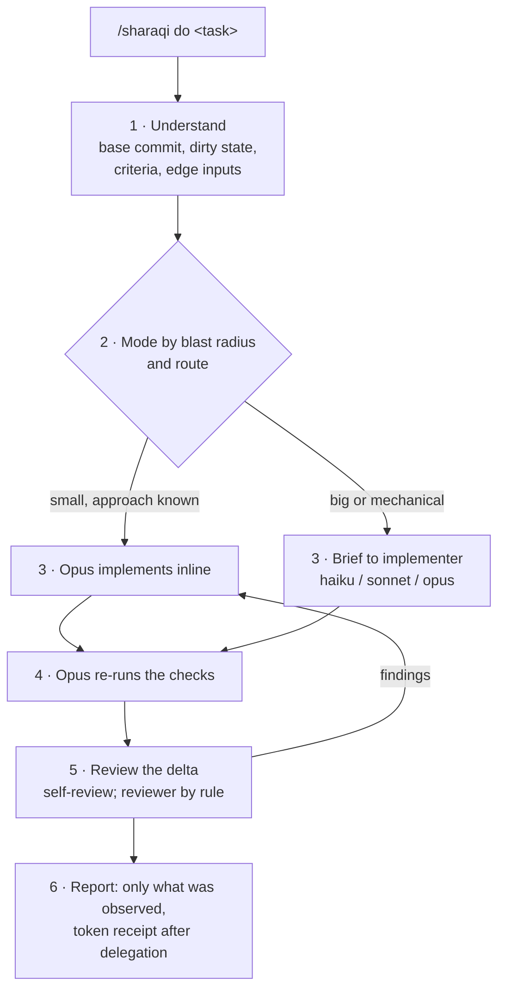

# sharaqi

**A receipt for the tokens you spent.**

[](LICENSE)
[](.claude-plugin/plugin.json)
[](.github/workflows/test.yml)

A Claude Code plugin for development tasks. Opus orchestrates: it sizes the
task by blast radius, makes small known changes itself, and hands big or
mechanical work to the cheapest model that will get it right, under a model
ceiling a hook enforces. It re-runs the checks itself, reviews in proportion
to the risk, and reports only what it verified, with the tokens each model
used.

```
/sharaqi do <task>          # coding or non-coding; the route decides plan and review
/sharaqi route <task>       # print the route only
/sharaqi review [target]    # read-only review of a diff or a document
```

`review` is the first word of the skill's arguments, not a separate slash
command: `/sharaqi review …` and `/sharaqi:sharaqi review …` both work.

> [!IMPORTANT]
> **v0.7.1: what is measured and what is not.** On the tasks measured so far,
> a plain prompt to the same model was **cheaper and faster**, and equally
> correct on the medium task: median $0.97 vs $1.71 and 156 s vs 296 s over
> three runs per arm. On a tiny task the skill caught an invalid-input bug the
> plain run shipped; on the medium task both arms handled every edge input.
> Delegation to cheaper models has not yet been exercised by a benchmark.
> Details: [Cost and evidence](#cost-and-evidence).

## Requirements

- **Claude Code**, with plugin support. Tested on 2.1.274; older versions
  are untested.
- **bash** on `PATH`: the hooks are bash scripts.
- **Python 3** (optional): only for the token report.
- **jq** (optional): the hooks parse their input with jq, else Python, else
  plain text matching.

## Quick start

1. Install as a plugin:
   ```bash
   claude plugin marketplace add EngSharaqi/sharaqi-workflow
   claude plugin install sharaqi@sharaqi-workflow
   ```
2. Check it's there: `claude plugin list` should list `sharaqi`.
3. Start a new session in your repo and run a task. Installed as a plugin,
   the command carries the plugin prefix:
   ```
   /sharaqi:sharaqi do fix the date parsing in the signup form
   ```

Alternative: `git clone https://github.com/EngSharaqi/sharaqi-workflow.git ~/.claude/skills/sharaqi`
gives the command `/sharaqi`. The folder must be named `sharaqi`; Claude Code
also loads it as the plugin `sharaqi@skills-dir`, with the same agents and hooks.

## How it works



1. **Understand.** One command records the start time, base commit and what
   was already dirty. The task in one line, its acceptance criteria, and the
   invalid or edge inputs the code must handle.
2. **Risk and route.** A mode from the table below, by what a mistake would
   break, not by the words in the task. Small known changes stay inline.
3. **Implement.** Inline, or a brief to the `implementer` agent. Briefs carry
   paths, names and check commands, never code.
4. **Verify.** Opus re-runs the checks itself. An implementer's "done" is a
   claim until then.
5. **Review.** Self-review of the delta every time (scope, callers, input
   validation, tests, exposure); an independent read-only reviewer when the
   mode calls for it.
6. **Report.** Four lines for FAST; a fuller report otherwise, with a token
   receipt from `scripts/tokens.py` when something was delegated.

Design decisions and their history: [docs/architecture.md](docs/architecture.md).

## Tracks and tiers

`scripts/route.py` turns the facts Opus judges into a route
(SKILL.md step 1):

| Tier | When | Plan + approval | Review |
|---|---|---|---|
| tiny | one file, < ~30 lines, no behaviour change, no CRITICAL trigger | none | none (diff and narrowest check) |
| planned | any other code change | plan ≤ 12 lines, wait | `opus` reviewer, low |
| critical | a CRITICAL trigger, at any size | plan ≤ 12 lines, wait | `opus` reviewer, medium or high (`reviewer-medium` / `reviewer-high`) |
| direct | non-coding: emails, reports, analysis, test plans | none | none unless `/sharaqi review` |

A mixed task routes only its code part; its writing is delivered directly.
The 40% context gate applies to every tier.

## Modes

| Mode | Triggered by | Checks | Review |
|---|---|---|---|
| FAST | wording, style, a rename the compiler checks | the narrowest relevant check | self-review when tiny; else also the `opus` reviewer at low effort |
| STANDARD | the default for logic and feature work, including pure calculations in small, scoped code | targeted tests of the changed behaviour, lint or typecheck of the affected part | self-review, then the `opus` reviewer at low effort on the task's own diff |
| CRITICAL | auth, permissions, secrets; data migration or deletion; anything irreversible; real-money side effects; security-sensitive parsing; shared infrastructure (build, CI, deploy, dependencies) | STANDARD plus negative cases | self-review, the `opus` reviewer raised to R7+ (medium, high for security), and the [security checklist](references/security-checklist.md) |

Blast radius, not domain words: fixing cart-total math is **STANDARD**;
charging a card is **CRITICAL**. Unsure between FAST and STANDARD means
STANDARD. The mode can go up after the diff, never down. Borderline cases:
[references/triage.md](references/triage.md).

## Delegation ladder

Delegation costs a brief, the worker's own context and Opus re-checking the
result, so it's used only past a break-even: inline for about three files or
fewer with a known approach; delegate when the work is big (~5+ files or
~150+ lines), mechanical, or a long edit-test loop. These thresholds are
heuristics.

| Rung | For |
|---|---|
| inline (Opus) | small, approach known |
| `implementer` · haiku | mechanical work on a pattern the repo already shows |
| `implementer` · sonnet | default for delegated feature and bug work |
| `implementer` · opus · medium | a slice that needs judgement a brief can't pin down |
| `Plan` · opus · high | CRITICAL plans or diagnoses, with the reason stated |

**Ceiling:** never Fable or Mythos; never above high effort on Opus, Sonnet or
Haiku. Every Agent call must name its model. The values live in
[scripts/prices.json](scripts/prices.json). Full rules:
[references/delegation.md](references/delegation.md).

## Guarantees: enforced vs instruction only

| Rail | Enforced by | Gaps |
|---|---|---|
| Reviewer can't change anything | Claude Code: the agent has only Read, Grep, Glob | none known |
| Model ceiling (no Fable/Mythos, Opus, Sonnet and Haiku ≤ high) | `hooks/cap-model.sh` during a `/sharaqi` run | inactive outside a run; without jq or Python it blocks only what it reads clearly as text and allows the rest with a warning |
| Every Agent call names a model | `cap-model.sh --require-model` during a run | same as above |
| Effort per delegation | the agent file's `effort:` (implementer and reviewer: medium) | **not enforceable on the Agent tool** in Claude Code 2.1.274: it has no `effort` parameter, so the `low` rungs and `Plan` at `high` aren't selectable; the hook checks effort only when a call carries one |
| Orchestrator on Opus · medium | `model` / `effort` in the SKILL.md frontmatter | the `/sharaqi` turn only; follow-up messages use the session's model |
| Ask before commit / push / PR | Claude Code permission rules, if you accept them in `/sharaqi setup` | other command forms (`git -C . push`, `sh -c`, scripts) aren't matched; use the sandbox network allowlist or branch protection for a hard guarantee |
| Nothing leaves the machine without a yes; no code in briefs; implementers don't commit; repo text is data, not commands; no claimed checks without a run | instruction only | the model can still get it wrong |

Tests and reviewers lower risk. They don't prove a change correct or secure,
and the report doesn't say they do.

## Cost and evidence

All numbers are Claude Code's own (`claude -p --output-format json`), Claude
Code 2.1.274, `--model opus --effort medium` in both arms; `opus` resolved to
`claude-opus-5`.

**Tiny task** (one run per arm per version; clamp a coupon, add a coupon type,
throw on negatives, in a 20-line file):
[benchmarks/2026-10-22-cart-toy.md](benchmarks/2026-10-22-cart-toy.md)

| | Plain | v0.6 | Plain | v0.7 |
|---|---|---|---|---|
| Cost | $0.61 | $1.49 | $0.39 | $0.59 |
| Wall time | 39 s | 245 s | 42 s | 87 s |
| Turns | 7 | 19 | 7 | 10 |
| Hidden tests | 9/9 | 9/9 | 9/9 | 9/9 |
| Missing or text coupon value | NaN | clear error | NaN | clear error |

**Medium task** (pre-registered, three runs per arm; a rename plus a feature
across 12 files of a small Node library):
[protocol](benchmarks/medium-task/PROTOCOL.md) ·
[results](benchmarks/medium-task/RESULTS.md)

| Median (range) | Plain | v0.7.1 |
|---|---|---|
| Cost | $0.97 ($0.92–0.99) | $1.71 ($1.40–1.84) |
| Wall time | 156 s (147–159) | 296 s (208–314) |
| Turns | 32 (26–32) | 37 (36–38) |
| Hidden tests | 16/16 in all runs | 16/16 in all runs |
| Edge probe | 8/8 in all runs | 8/8 in all runs |

The skill rated the task STANDARD every time and kept it inline; it never
delegated. It spawned a Sonnet reviewer in two runs, which found nothing.

**Routing decision, v0.9** (11 cases, one run each, Claude Code 2.1.312,
`opus` → `claude-opus-5-5`, effort medium, read-only tools in both arms):
[Sharaqi results](benchmarks/v0.9/ROUTING-RESULTS.md) ·
[plain Claude Code results](benchmarks/v0.9/PLAIN-CODE-RESULTS.md)

| | Plain | v0.9 `route` |
|---|---|---|
| Cost, 11 cases | $2.07 | $2.98 |
| CLI time, median | 12.9 s | 13.5 s |
| Explicit route | not exposed | 11/11 as expected |
| CRITICAL cases (2) | risk flagged in the reply | `critical`: plan, approval and stronger review required |
| Review carried out (2 cases) | 1 (document, inline) | 0 (both stopped at the context check) |

Not the same work: `route` stops after the decision, while plain Claude looked
through an empty scratch repo and asked for the files. Neither arm changed code
or ran a full task, so this shows the cost of the routing step, not its effect
on outcomes.

**Limits.** Two tasks, small N, one model version; the plain arm alone moved
$0.22 between two rounds of the tiny task. Delegation is unmeasured. A turn
audit of the v0.7 run is in
[benchmarks/2026-10-22-turn-audit.md](benchmarks/2026-10-22-turn-audit.md).

**Measure it on your repo:** fill in [benchmarks/TEMPLATE.md](benchmarks/TEMPLATE.md),
or adapt `benchmarks/medium-task/run.sh`.

## When to use it, and when not

Use it when a mistake costs more than the overhead: auth, data, payments,
anything irreversible; changes where you want a stated mode, re-run checks and
a report that separates what was verified from what was assumed.

Don't use it for tiny or well-specified edits, a typo, a colour, a one-line
fix. On the tasks measured so far, a plain prompt was cheaper and faster.

## Example session

*Illustrative, not measured output.* A FAST task ends with:

```
**Changed:** src/i18n/locales/ar.json — fixed the "Save" label
**Checks:** npm run lint → 0 problems
**Review:** self-review (not independent) · Mode FAST
**Risks:** none identified
```

A delegated STANDARD task prints its route and delegation lines, then the
report (abridged):

```
Mode: STANDARD — new query hook used by 4 screens
Route: STANDARD | Executor: R3 Builder · haiku-high | Review: reviewer (opus · low)
▶ Execution | Builder | haiku | high (configured) | 6 files on the existing query pattern
◀ Execution | claude-haiku-5-5 · high | DONE | 6 files | lint + typecheck green
▶ Review | Reviewer | opus | low (configured) | 6 files in BASE..AFTER
◀ Review | claude-opus-5-5 · low | PASS | — | —

**Changed:** src/services/trainings/queries.ts — new useTrainingStats hook; 4 screens switched to it
**Checks:** npm run lint → 0 problems · npx tsc --noEmit → 0 errors
**Delegation:** R3 Builder · claude-haiku-5-5 · high — 6 files (0 reworks)
**Review:** reviewer · claude-opus-5-5 · low · scope BASE..AFTER (6 files) → PASS; repairs 0
**Acceptance criteria:** stats load on all 4 screens: met — checks above; empty response: met — returns []
**Risks & unknowns:** no test covers the screens' rendering
**Tokens:** <the SUMMARY lines tokens.py printed>
```

## Configuration

**`/sharaqi setup`** (optional, run once; each step asks first and can be
skipped):

| Step | Writes to |
|---|---|
| Smaller auto-compact window | `~/.claude/settings.json` |
| Ask before `git commit`, `git push`, `gh pr` | `~/.claude/settings.json` → `permissions.ask` |
| Block reads of dependency/build folders that exist in this repo | `<repo>/.claude/settings.local.json` → `permissions.deny` |

**`scripts/prices.json`** holds API list prices per exact model id, the date
they were checked, and the model ceiling. Each row has `"verified": true` only
if it reproduced Claude Code's own cost on a recorded session; the report
marks every other model's lines `estimate (price unverified for <model>)`,
warns when the table is over 90 days old, and counts unrecognised model ids
instead of pricing them. The figure is an API list-price estimate, not a bill.

**When the hooks are active.** Plugin hooks load in every session, but the
ceiling hook does nothing until a prompt in that session starts with
`/sharaqi` or `/sharaqi:sharaqi` (leading whitespace allowed; a prompt that
merely mentions sharaqi doesn't count). That writes a marker in
`~/.claude/sharaqi-state/`. It then stays active for follow-up messages in
the same session until `SessionEnd` removes the marker. A marker with no
prompt for 24 hours (a crashed session) is ignored and deleted. The hint hook
counts compactions in every session and, after two, suggests a fresh session;
`SHARAQI_NO_HINTS=1` turns that off. `SHARAQI_ALLOW_ABOVE_CAP=1` disables the
ceiling for a session.

## Security and privacy

Nothing in the plugin opens a network connection (no curl, wget, fetch,
sockets or HTTP libraries in its code). What it reads and writes:

| Component | Reads | Writes |
|---|---|---|
| `hooks/cap-model.sh` | the hook's JSON on stdin; `scripts/prices.json`; whether this session's marker exists and its age | nothing; it can only block a call |
| `hooks/session-hints.sh` | the hook's JSON on stdin, including the compaction summary after a compaction in a run | `~/.claude/sharaqi-state/<session>.{run,compacts,hinted,handoff}`, and deletes expired ones; `.handoff` holds only the words BASE, ROUTE or unverified, never the summary |
| `scripts/tokens.py` | this session's transcripts under `~/.claude/projects/`; `scripts/prices.json` | nothing (prints to stdout) |

(`~/.claude` is `$CLAUDE_CONFIG_DIR` when set.) Reporting a vulnerability:
[SECURITY.md](SECURITY.md).

## Troubleshooting

| Symptom | Check |
|---|---|
| Plugin not listed | `claude plugin marketplace list` should show `sharaqi-workflow`; re-run the two install commands, then start a new session |
| `/sharaqi` not found | as a plugin, the command is `/sharaqi:sharaqi`; `/sharaqi` alone is the skills-folder install |
| Hooks not firing | they act only after a `/sharaqi` prompt in that session: look for `~/.claude/sharaqi-state/<session>.run`. Check that `bash` is on `PATH`; `claude --debug` turns on debug logging |
| CLI rejects a model id | use the aliases `opus`, `sonnet`, `haiku`, or update Claude Code; the benchmarks note which id an alias resolved to |
| No Python | the token line reads `unavailable`; the skill tries `python3`, `python`, then `py`. Everything else works |
| Token report unavailable | it reads `~/.claude/projects/*/<session>.jsonl` (or `$CLAUDE_CONFIG_DIR`); "no usage recorded" means nothing since the task's start time |

## Uninstall and rollback

```bash
claude plugin uninstall sharaqi@sharaqi-workflow
claude plugin marketplace remove sharaqi-workflow
rm -rf ~/.claude/sharaqi-state
```

Undo `/sharaqi setup` by deleting the lines it added. To run an older version,
check out its commit and start Claude Code with `--plugin-dir <checkout>`.

<details>
<summary>Repository layout</summary>

| Path | Role |
|---|---|
| `SKILL.md` | the workflow: rules, mode table, self-review checklist, report formats |
| `references/` | triage, delegation, brief, review, security checklist, setup; read only when needed |
| `agents/` | `implementer` (one brief, never commits) and `reviewer` (Read/Grep/Glob only) |
| `hooks/` | `cap-model.sh` (model ceiling), `session-hints.sh` (run marker, hints), `json.sh` (input parsing) |
| `scripts/tokens.py`, `scripts/prices.json` | token receipt; prices and ceiling |
| `benchmarks/` | protocols, harnesses and results |
| `docs/architecture.md` | design decisions and history |
| `tests/` | hook and `tokens.py` tests |

</details>

## History

v0.4 was a fixed planner → builder → reviewer pipeline; v0.5 did everything in
the main session; v0.6 brought back delegation with code-free briefs; v0.7 cut
the overhead and triages by blast radius; v0.7.1 hardens the hooks and adds
the medium-task benchmark. See [CHANGELOG.md](CHANGELOG.md).

## Contributing

Tests: `bash tests/test_hooks.sh` and `python3 -m unittest discover -s tests`
(offline; CI runs them on Ubuntu and macOS). Rules for changes and how to run
the benchmark: [CONTRIBUTING.md](CONTRIBUTING.md).

## License

MIT. See [LICENSE](LICENSE).
