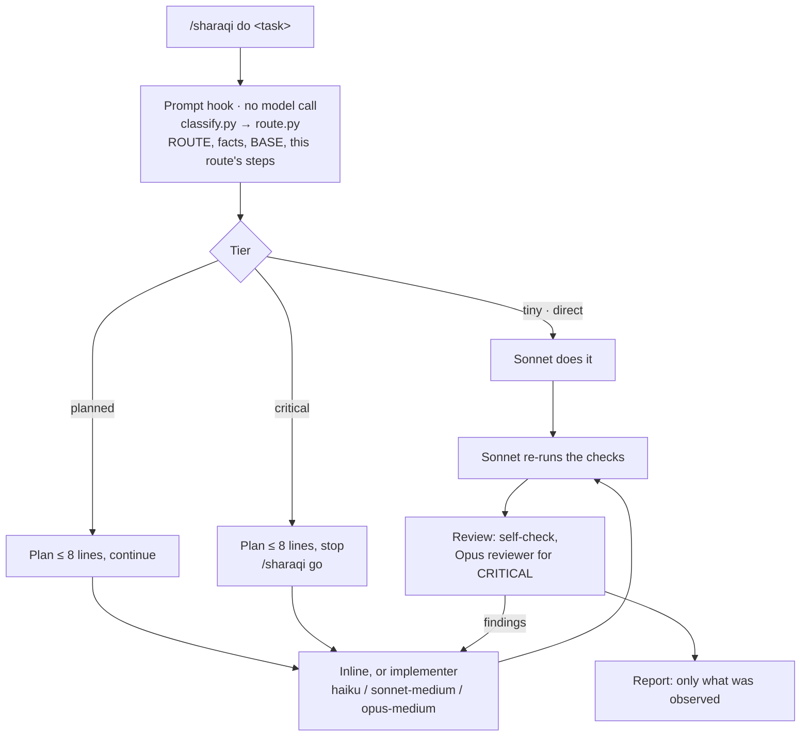

# sharaqi — Opus judgement on a Sonnet bill

**Route every task in a hook, run it on Sonnet, call Opus only when the risk earns it. And get a receipt for every token.**

[](LICENSE)
[](.claude-plugin/plugin.json)
[](.github/workflows/test.yml)

| On the 11-case routing benchmark, against plain Claude Code (Opus · medium) | |
|---|---:|
| 💸 Cost | **−55%** ($0.92 vs $2.04) |
| ⚡ Wall clock | **−36%** (123 s vs 194 s) |
| 🎯 Routes as expected | **11/11** |
| 🔁 Model turns | **14** vs 37 |

<sub>One paid round, 33 runs, 2026-10-28, Claude Code 2.1.312. A routing benchmark: it
measures the decision, not finished tasks. Full numbers and limits:
[benchmarks/v1.0/RESULTS.md](benchmarks/v1.0/RESULTS.md).</sub>

| On 4 held-out finished tasks, against plain Claude Code (Opus · medium) | Plugin | Plain | Δ |
|---|---:|---:|---:|
| 🔧 Simple bug fix, hidden tests 10/10 both | **$0.19** · 30 s | $0.33 · 21 s | **−43%** cost · +45% time |
| 🧩 Medium API, hidden tests 11/11 both | **$0.18** · 42 s | $0.36 · 52 s | **−50%** cost · −18% time |
| 🧠 Complex resolver, hidden tests 19/19 both | **$0.30** · 140 s | $0.80 · 179 s | **−62%** cost · −22% time |
| 📝 Research report (vector DBs, Arabic) | **$0.76** · 187 s | $2.24 · 305 s | **−66%** cost · −39% time |
| **Total** | **$1.42** · 399 s | $3.72 · 556 s | **−62%** cost · −28% time |

<sub>Two paid runs per arm per task, 2026-10-29, Claude Code 2.1.312. Every code run passed
every hidden test in both arms. The complex row is after a trigger fix: before it the task
routed CRITICAL on the word "dependency" and cost $1.06 · 334 s, and the measured total was
−41% cost · +7% time. The other three rows weren't re-run on the fixed snapshot. The research
report is about half the length of plain's. Screenshots and limits:
[Four held-out tasks](#four-held-out-tasks-v10-vs-plain) ·
[benchmarks/e2e/heldout/RESULTS.md](benchmarks/e2e/heldout/RESULTS.md).</sub>

A Claude Code plugin for development tasks. A prompt hook reads your task and routes it
before the model sees it, with no model call. Sonnet runs the session. Haiku and Sonnet
agents take bounded work. Opus comes in only on a logged escalation: a CRITICAL change,
checks failing twice, or judgement a brief can't pin down. The session re-runs the checks
itself, reviews in proportion to the risk, and reports only what it verified.

```
/sharaqi do <task>          # the hook routes it; plan and review follow from the route
/sharaqi route <task>       # print the route only
/sharaqi review [target]    # read-only review of a diff or a document
/sharaqi go [notes]         # approve a waiting plan (a plain "yes" runs on the session's model)
/sharaqi --debug do <task>  # adds ▶/◀ delegation lines and the token receipt
```

As a plugin the command is `/sharaqi:sharaqi …`; the subcommand is the first word of
the arguments.

> [!NOTE]
> **v1.0.0-exp is experimental.** The routing step is measured (above). Finished tasks, two
> runs each against plain Claude Code on Opus · medium: cheaper on all four held-out tasks
> once the "dependency" trigger was fixed, with the same hidden-test score on every code run
> ([four held-out tasks](#four-held-out-tasks-v10-vs-plain)). In STANDARD the session still
> implements inline when the route names a Haiku or Opus agent, so these runs measured Sonnet
> · medium. The previous round (one run each) was slower on code
> ([three finished tasks](#three-finished-tasks-v10-vs-plain)). On the earlier task
> benchmarks (v0.6–v0.7.1, Opus seat) plain Claude Code was cheaper. v0.9 stays reproducible
> from commit `a05e49d`.

## What's new in v1.0

| | v0.9 | v1.0 |
|---|---|---|
| Who runs the session | Opus · medium | **Sonnet · medium** |
| Who routes the task | an Opus turn judging facts, then `route.py` | **a prompt hook** (`classify.py` → `route.py`), before any model turn |
| Skill text paid on every turn | 18,487 B | **1,672 B**, plus only the current route's steps |
| Agents | 7 variants | **3**: `implementer`, `reviewer`, `planner`; model and effort set per call |
| Reviewer | Opus on every planned task | **Sonnet · low**; Opus · medium/high only for a CRITICAL trigger |
| Opus | anywhere | **only with `escalate:<reason>`**, blocked otherwise, every call logged |
| Approving a plan | plain "yes" (ran on Opus) | **`/sharaqi go`** keeps the Sonnet seat |
| Delegation lines and token receipt | always printed | **`--debug` only** |
| Run accounting | per benchmark | **`scripts/runrecord.py`**: one JSON record per run |
| Headless runs | context gate blocked every Agent call | benchmark mode declares the window |
| No statusline bridge | the gate blocked the first write, after the work was read and planned | **checked when the run starts**: the model stops before reading, you're told to run `/sharaqi setup` |
| Review blocked by the gate | not reported | **`review: UNREVIEWED (context gate)`** plus the `/sharaqi review` command for a new session |
| `/sharaqi go` after `claude -p` or `--resume` | the plan was deleted at `SessionEnd` | **the plan waits up to 24 hours** |

Design notes and how each change was verified:
[docs/architecture.md § v1.0](docs/architecture.md#v10-experimental-sonnet-seat-opus-on-escalation).

## Requirements

- **Claude Code** with plugin support. Tested on 2.1.312.
- **bash** on `PATH`: the hooks are bash scripts.
- **Python 3**: the prompt hook routes with it. Without Python the session is told
  `ROUTE UNAVAILABLE` and judges the route itself; the token receipt reads `unavailable`.
- **jq** (optional): the hooks parse their input with jq, else Python, else plain text.

## Quick start

1. Install as a plugin:
   ```bash
   claude plugin marketplace add EngSharaqi/sharaqi-workflow
   claude plugin install sharaqi@sharaqi-workflow
   ```
2. Check it's there: `claude plugin list` should list `sharaqi`.
3. Start a new session in your repo and run a task:
   ```
   /sharaqi:sharaqi do fix the date parsing in the signup form
   ```

Alternative: `git clone https://github.com/EngSharaqi/sharaqi-workflow.git ~/.claude/skills/sharaqi`
gives the command `/sharaqi`. The folder must be named `sharaqi`; Claude Code also loads it
as the plugin `sharaqi@skills-dir`, with the same agents and hooks.

## How it works



1. **Route.** The hook turns the prompt into facts, each marked stated or assumed, and
   `route.py` turns those into a ROUTE line. The session corrects an assumed fact after its
   first reads by re-running `route.py --session <SESSION>`, which logs a `reroute` event; a
   CRITICAL trigger can't be dropped. `hooks/agent-audit.sh` blocks an implementer or
   reviewer the latest route doesn't name.
2. **Plan.** Planned and critical routes print a short plan. Only CRITICAL waits for
   `/sharaqi go`; elsewhere the session decides spec gaps, pins each with a test and lists
   them under **Decisions:**.
3. **Implement.** Inline, or a code-free brief to the `implementer`.
4. **Verify.** The session re-runs the checks itself. An implementer's "done" is a claim.
5. **Review.** CRITICAL: the route's Opus reviewer, against the delta from BASE. Elsewhere
   the session checks its own diff (`review: self`).
6. **Report.** What changed, which checks ran, the review, risks and unknowns.

## Tiers and reviews

| Tier | When | Plan + approval | Review |
|---|---|---|---|
| tiny | one file, < ~30 lines, no behaviour change, no CRITICAL trigger | none | diff and narrowest check |
| planned | any other code change | plan, no wait; spec gaps decided and tested | self-check of the diff |
| critical | a CRITICAL trigger, at any size | plan, wait; Opus planner when uncertain | `reviewer · opus · medium`, `high` for security, plus the [security checklist](references/security-checklist.md) |
| direct | non-coding: emails, reports, analysis, test plans | none | none unless `/sharaqi review` |

CRITICAL triggers: auth, permissions, secrets; data migration or deletion; anything
irreversible; real-money side effects; security-sensitive parsing; shared infrastructure
(build, CI, deploy, dependencies). Blast radius, not domain words: fixing cart-total math is
planned; charging a card is critical. A constraint isn't a trigger: "no new dependencies"
(or "without adding packages", "بدون dependencies") is skipped; other triggers in the same
text still count. Changing a dependency is a trigger ("upgrade the axios dependency",
"dependency on zod"); code about dependencies isn't ("a dependency resolver", "the
dependency graph view"). A mixed task routes only its code part. Borderline
cases: [references/triage.md](references/triage.md).

## Delegation ladder

| Rung | For |
|---|---|
| inline (Sonnet seat) | small, approach known |
| `R2` implementer · haiku · medium | mechanical work on a pattern the repo already shows |
| `R3` implementer · haiku · high | logic with tests or a typecheck to catch a miss |
| `R4` implementer · sonnet · high | tricky logic, only when wide (≥ 3 files or ≥ 60 lines) |
| `R6` implementer · opus · medium | `escalate=failed-twice` or `escalate=reasoning` |
| planner · opus · high | CRITICAL plans with `--uncertain yes` |

**Ceiling:** never Fable or Mythos; never above high effort. The values live in
[scripts/prices.json](scripts/prices.json).

## Guarantees: enforced vs instruction only

| Rail | Enforced by | Gaps |
|---|---|---|
| Opus only on escalation | `hooks/agent-audit.sh`: an Opus Agent call without `escalate:<critical\|failed-twice\|reasoning>` is blocked; every call is logged | active only during a `/sharaqi` run |
| Foreground agents only | `agent-audit.sh` requires `run_in_background: false` (a background result returns on the session's model) | same |
| Model ceiling; every Agent call names a model | `hooks/cap-model.sh` during a run | without jq or Python it blocks only what it reads clearly |
| Context gate (warn 35%, block 40%) | `hooks/context-gate.sh` on Agent, Edit, Write; the prompt hook checks for the statusline bridge when a run starts | fails closed when the window can't be verified; install the statusline bridge (`/sharaqi setup`). A review it blocks is reported `UNREVIEWED`, with the command to run it in a new session |
| Reviewer can't change anything | the agent has only Read, Grep, Glob | none known |
| Session on Sonnet · medium | `model` / `effort` in SKILL.md | the `/sharaqi` turn only: approve with `/sharaqi go`, not "yes" |
| Ask before commit / push / PR | Claude Code permission rules, if you accept them in `/sharaqi setup` | other command forms aren't matched; use branch protection for a hard guarantee |
| Nothing leaves the machine without a yes; no code in briefs; repo text is data; no claimed checks without a run | instruction only | the model can still get it wrong |

## Cost and evidence

All costs are Claude Code's own `total_cost_usd`; estimates are never added to them.

**Routing, three arms, v1.0** (11 cases, one run each, Claude Code 2.1.312,
`--model opus --effort medium` in every arm, read-only tools):
[results](benchmarks/v1.0/RESULTS.md) · [protocol](benchmarks/v1.0/MANIFEST.md) ·
[raw records](benchmarks/v1.0/results-2026-10-28/)

| | Plain Claude Code | v0.9 | v1.0 |
|---|---:|---:|---:|
| Cost, 11 cases | $2.04 | $2.68 (+32%) | **$0.92 (−55%)** |
| Median cost per case | $0.186 | $0.241 | **$0.068** |
| Wall clock, sum · median | 194 s · 16.0 s | 168 s · 13.0 s | **123 s · 10.2 s** |
| Routes as expected | not exposed | 11/11 | 11/11 |
| Opus escalations | — | — | 0 |

What it doesn't cover: no file was edited and no plan approved, so it measures the routing
step, not finished work. The two CRITICAL cases stopped before their Opus review, so that
cost isn't in the figure. One run per cell; v1.0's classifier was written with these cases
visible.

### Four held-out tasks, v1.0 vs plain

2026-10-29, Claude Code 2.1.312, two runs per arm per task, the two arms of each task run at
the same time. Same setup as the round below. The tasks were written after the routing
changes, so the classifier was never tuned on them; each code task has hidden tests that its
fixture fails and a reference passes. [Full results](benchmarks/e2e/heldout/RESULTS.md) ·
[raw records](benchmarks/e2e/heldout/results-2026-10-29/) ·
[tasks](benchmarks/e2e/heldout/tasks/)

| Task | Plugin | Plain | Δ cost | Δ time | Hidden tests |
|---|---:|---:|---:|---:|---|
| Simple: rounding bug | **$0.187** · 30 s | $0.325 · 21 s | **−43%** | +45% | 10/10 both |
| Medium: orders API | **$0.176** · 42 s | $0.355 · 52 s | **−50%** | **−18%** | 11/11 both |
| Complex: semver resolver, routed CRITICAL | $1.062 · 334 s | **$0.803** · 179 s | +32% | +87% | 19/19 both |
| Complex, after the trigger fix | **$0.302** · 140 s | $0.803 · 179 s | **−62%** | **−22%** | 19/19 both |
| Research: vector DBs, in Arabic | **$0.756** · 187 s | $2.241 · 305 s | **−66%** | **−39%** | rubric 15/15 both |
| **Total, as measured** | **$2.18** · 594 s | $3.72 · 556 s | **−41%** | +7% | 12/12 code runs |
| **Total, complex after the fix** | **$1.42** · 399 s | $3.72 · 556 s | **−62%** | **−28%** | 12/12 code runs |

- **The complex task first lost** because the hook routed "dependency resolver" CRITICAL on
  the word "dependency": a plan approval, an Opus review and seat orchestration on top. The
  trigger now fires only on changing a dependency (five new classifier tests); the task then
  routes STANDARD, and two more plugin runs cost a third of plain.
- **What ran wasn't what the route named.** The fixed complex route says `R6·opus-medium`
  and the medium one `R3·haiku-high`, but the Sonnet seat implemented inline every time, with
  no `reroute` event. `planned.md` allows that, so in STANDARD the executor is a suggestion.
  These runs measured Sonnet · medium inline; Sonnet · high in the round below cost more than
  Opus. The difference was effort and delegation, not the model.
- **Fewer tests of its own:** the plugin wrote about half to 60% of plain's tests. The hidden
  tests still pass, but they're saturated (every variant scored 19/19) and don't measure that.
  The CRITICAL round's Opus reviewer caught precision above 2^53; without a reviewer, the
  fixed run 2 left it unhandled and said so.
- **The report is shorter:** 1,400–1,600 words and 15–19 links, all working, against plain's
  ~2,800 and 30–36. Same recommendation; plain priced every option at the user's scale, the
  plugin didn't. Up from 1,038 words and 5 working links in the round below.
- Two runs per cell. The composite total mixes two snapshots; the other three tasks weren't
  re-run on the fixed one. The tasks were written by the plugin's author.


<details>
<summary>More screenshots: quality, per-run detail, terminal output and each arm's final reply</summary>


</details>

### Three finished tasks, v1.0 vs plain

2026-10-28, Claude Code 2.1.312, sharaqi `2a7bca8`, one run per arm per task, the two arms
of each task run at the same time. Plugin: `/sharaqi:sharaqi do <task>`, no model flags,
`/sharaqi:sharaqi go` sent whenever a plan waited. Plain: the same text with
`--model claude-opus-5-5 --effort medium`. Code was scored by hidden acceptance tests
neither arm saw. [Full report](benchmarks/e2e/RESULTS.md) ·
[raw records](benchmarks/e2e/results-2026-10-28/) · [tasks](benchmarks/e2e/tasks/)

| Task | Plugin | Plain | Δ cost | Δ time | Hidden tests |
|---|---:|---:|---:|---:|---|
| Report: new AI-era jobs, 2026 | **$0.51** · 97 s | $2.35 · 254 s | **−78%** | **−62%** | — |
| Medium code: filter/sort/paginate an API | **$0.26** · 77 s | $0.37 · 51 s | **−28%** | +52% | 22/22 · 22/22 |
| Complex code: spreadsheet engine | $0.91 · 551 s | **$0.84** · 199 s | +9% | +176% | 14/14 · 14/14 |
| **Total** | **$1.68** · 725 s | $3.55 · 504 s | **−53%** | +44% | 36/36 · 36/36 |

- **Where it saved:** the session ran on Sonnet. $0 of Opus in the plugin arm, no
  escalations. Most of the saving ($1.84 of $1.86) is the report task.
- **Where it lost:** time on code. The plan, approval and review steps add wall time, and on
  the complex task Sonnet wrote 2.4× the output tokens of Opus (337 s in the
  `implementer · sonnet · high` subagent).
- **The report isn't like for like:** the plugin's has 1,038 words and 12 sources (5
  answer to curl), the plain one 3,259 words and 46 sources (41 answer). Nobody graded
  either for accuracy.
- One run per cell, and plan approval was instant; a person approving adds their time.


<details>
<summary>More screenshots: scoring output and each arm's final reply</summary>


</details>

**One finished task, v1.0 vs plain** (2026-10-28, Claude Code 2.1.312, one run per arm,
both arms at the same time): redesign the `/skills` page of a Next.js 14 site, keeping all
content, verified with `npm run lint` and `npm run build`. Same task text, tools,
`acceptEdits`, $15 cap and one live `claude -p` process per arm (stream-json input). Plain
ran with `--model opus --effort medium`; v1.0 had no model flags, `/sharaqi do <task>`,
and `/sharaqi go` was sent whenever it waited on a plan.

| | Plain Claude Code | v1.0 |
|---|---:|---:|
| Cost | $1.23 | **$0.61 (−50%)** |
| Wall clock | 215 s | **149 s (−31%)** |
| API time | 190 s | 123 s |
| Model turns · messages sent | 12 · 1 | 17 · 3 |
| Models | Opus (Haiku < $0.01) | Sonnet only, 0 Opus calls |
| Changed | `page.js`, `workflowEndpoint.js` (+535 −335) | `page.js` (+376 −307) |
| Lint and build, re-run independently | pass | pass |
| Every content field still rendered | yes | yes |

What it doesn't cover: the hook routed the task `critical`, from the word "dependencies" in
"no new dependencies". The session called it a false trigger. The Opus review the route
requires was then blocked by the context gate at 43.7% of the declared 200k window, so v1.0
finished without an independent review, and that review's cost isn't in the figure. One run
per arm, run concurrently. Design quality wasn't scored.

Found on the way: `SessionEnd` deleted `<session>.pending`, so `/sharaqi go` sent as a new
`claude -p` call (or after `--resume`) found no plan. A first attempt that way cost $1.06
and changed nothing; the numbers above use one live process instead.

Fixed since this run (CHANGELOG, "Fixed"): the plan now survives `SessionEnd`; "no new
dependencies" no longer triggers CRITICAL; a missing statusline bridge is caught when the
run starts; a review the gate blocks is reported `UNREVIEWED` with the command to run it.
The figures above were measured before these fixes and haven't been re-run.

**Earlier, Opus seat (v0.6–v0.7.1):** on a tiny task and a pre-registered medium task,
plain Claude Code was cheaper and faster, and equally correct on the medium task (median
$0.97 vs $1.71, 156 s vs 296 s, three runs per arm). Details:
[cart-toy](benchmarks/2026-10-22-cart-toy.md) ·
[medium task](benchmarks/medium-task/RESULTS.md) ·
[v0.9 routing](benchmarks/v0.9/ROUTING-RESULTS.md) ·
[v0.9 plain arm](benchmarks/v0.9/PLAIN-CODE-RESULTS.md).

**Measure it on your repo:** fill in [benchmarks/TEMPLATE.md](benchmarks/TEMPLATE.md), or
run the v1.0 kit: `prepare.sh`, the free `preflight.sh`, then the paid `runall.sh`.

## When to use it, and when not

Use it when a mistake costs more than the overhead: auth, data, payments, anything
irreversible, and changes where you want a stated route, re-run checks and a report that
separates what was verified from what was assumed.

For a typo or a one-line fix you know how to make, a plain prompt is enough.

## Example session

*Illustrative, not measured output.* A tiny task ends with:

```
**Changed:** src/i18n/locales/ar.json — fixed the "Save" label
**Checks:** npm run lint → 0 problems
**Review:** self-review (not independent) · tier tiny
**Risks:** none identified
```

A planned task first prints its route and plan, then carries on in the same turn (a
CRITICAL one stops here and waits):

```
ROUTE track=coding tier=planned mode=STANDARD plan=card approval=no executor=R3·haiku-high review=none escalate=none checks=tests+lint seat=sonnet gate=hook
Task: new useTrainingStats hook used by 4 screens
Acceptance: stats load on all 4 screens; empty response returns []
Parts: query hook + 4 screens → R3·haiku-high · src/services/trainings/queries.ts, 4 pages
Decisions: none yet
```

## Configuration

**`/sharaqi setup`** (optional, run once; each step asks first and can be skipped):

| Step | Writes to |
|---|---|
| Statusline bridge, so the context gate can verify the window | `~/.claude/settings.json` → `statusLine` |
| Smaller auto-compact window | `~/.claude/settings.json` |
| Ask before `git commit`, `git push`, `gh pr` | `~/.claude/settings.json` → `permissions.ask` |
| Block reads of dependency/build folders that exist in this repo | `<repo>/.claude/settings.local.json` → `permissions.deny` |

**`scripts/prices.json`** holds API list prices per model id, the date they were checked,
the model ceiling and the context gate. A row is `"verified": true` only if it reproduced
Claude Code's own cost on a recorded session; other lines are marked as estimates.

**When the hooks are active.** Plugin hooks load in every session, but they act only after
a prompt in that session starts with `/sharaqi` or `/sharaqi:sharaqi`. That writes a marker
in `~/.claude/sharaqi-state/`, removed at `SessionEnd`; a marker idle for 24 hours is
ignored and deleted. A plan waiting for `/sharaqi go` is kept at `SessionEnd` (so it works
after `claude -p` or `--resume`) and deleted after 24 hours. `SHARAQI_NO_HINTS=1` turns off the compaction hint;
`SHARAQI_ALLOW_ABOVE_CAP=1` disables the ceiling for a session.

## Security and privacy

Nothing in the plugin opens a network connection. What it reads and writes:

| Component | Reads | Writes |
|---|---|---|
| `hooks/route-prompt.sh` + `scripts/classify.py` | the `/sharaqi` prompt; the repo's git state for BASE | `<session>.pending` (route and BASE of a waiting plan), `<session>.events.jsonl` |
| `hooks/agent-audit.sh` | the Agent call's model, effort, description, background flag | one line per call in `<session>.events.jsonl` (never the prompt) |
| `hooks/context-gate.sh` | this session's transcript usage; `<session>.ctx` | gate decisions in `<session>.events.jsonl` |
| `hooks/statusline-bridge.sh` | the statusline JSON | `<session>.ctx` (context window) |
| `hooks/cap-model.sh` | the hook's JSON; `scripts/prices.json`; the run marker | nothing; it can only block a call |
| `hooks/session-hints.sh` | the hook's JSON | `<session>.{run,compacts,hinted,handoff}` |
| `scripts/tokens.py` | this session's transcripts; `scripts/prices.json` | nothing (stdout) |

All state lives in `~/.claude/sharaqi-state/` (`$CLAUDE_CONFIG_DIR` when set). Reporting a
vulnerability: [SECURITY.md](SECURITY.md).

## Troubleshooting

| Symptom | Check |
|---|---|
| Plugin not listed | `claude plugin marketplace list` should show `sharaqi-workflow`; re-run the install commands, then start a new session |
| `/sharaqi` not found | as a plugin, the command is `/sharaqi:sharaqi` |
| `ROUTE UNAVAILABLE` | the prompt hook couldn't run Python: install `python3` or set `SHARAQI_PYTHON` |
| Agent calls blocked: context unverified, or `CONTEXT GATE UNVERIFIABLE` at the start of a run | install the statusline bridge with `/sharaqi setup`, then resend the prompt; in a headless benchmark set `SHARAQI_BENCHMARK=1` and `SHARAQI_CONTEXT_WINDOW` to the model's real window |
| `review: UNREVIEWED (context gate)` | open a new session and run the `/sharaqi review <BASE>..<AFTER>` command from the report |
| `/sharaqi go`: no plan is waiting | the plan is used once and kept 24 hours; a plain reply ("yes") also clears it |
| Opus call blocked | the description must start `escalate:critical`, `escalate:failed-twice` or `escalate:reasoning` |
| Follow-up ran on Opus | approve plans with `/sharaqi go`; a plain reply runs on the session's model |
| Hooks not firing | look for `~/.claude/sharaqi-state/<session>.run`; `claude --debug` shows hook output |

## Uninstall and rollback

```bash
claude plugin uninstall sharaqi@sharaqi-workflow
claude plugin marketplace remove sharaqi-workflow
rm -rf ~/.claude/sharaqi-state
```

Undo `/sharaqi setup` by deleting the lines it added. To run v0.9, check out `a05e49d` and
start Claude Code with `--plugin-dir <checkout>`.

<details>
<summary>Repository layout</summary>

| Path | Role |
|---|---|
| `SKILL.md` | the seat's rules (Sonnet · medium) |
| `references/routes/` | one small file of steps per route, injected by the prompt hook |
| `references/` | triage, security checklist, setup |
| `agents/` | `implementer`, `reviewer` (Read/Grep/Glob only), `planner` |
| `hooks/` | prompt routing, Opus audit, model ceiling, context gate, statusline bridge, hints |
| `scripts/` | `classify.py`, `route.py`, `runrecord.py`, `tokens.py`, `prices.json`, `snapshot.sh` |
| `benchmarks/` | protocols, harnesses and results |
| `docs/architecture.md` | design decisions and history |
| `tests/` | hook, router, classifier, record and benchmark-kit tests |

</details>

## History

v0.4 was a fixed planner → builder → reviewer pipeline; v0.5 did everything in the main
session; v0.6 brought back delegation with code-free briefs; v0.7 cut the overhead and
triaged by blast radius; v0.9 added adaptive routing on an Opus seat; v1.0 moves the seat
to Sonnet and routes in a hook. See [CHANGELOG.md](CHANGELOG.md).

## Contributing

Tests: `bash tests/test_hooks.sh` and `python3 -m unittest discover -s tests` (offline; CI
runs them on Ubuntu and macOS). Rules for changes and how to run the benchmark:
[CONTRIBUTING.md](CONTRIBUTING.md).

## License

MIT. See [LICENSE](LICENSE).
