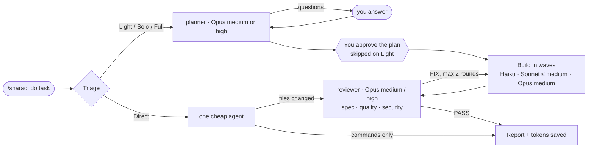

# 🎼 sharaqi — the conductor

**One command. The right model for every step. A receipt for the tokens you saved.**

```
/sharaqi do build a calculator app with a history panel
```

sharaqi is a Claude Code skill that works like a conductor. Opus thinks: it asks what matters, writes the PRD, the plan and a task card for every piece of work, at `medium` effort when the task is already clear (a ticket with acceptance criteria) and `high` when it isn't. Cheaper models play: each card goes to the cheapest agent that can do it, with the model and effort set per card. Because cheap models write the code, **every run that changes a file is reviewed**: Opus `medium` by default, Opus `high` when the diff is large or risky. The reviewer checks three axes (spec, quality, **security**), re-runs the builders' checks instead of trusting their reports, writes fix cards, and hands them back to a cheap model. Every time a model or effort changes, you see who is playing. At the end you get a report: what was done, who did what, and what it cost compared with doing all of it on Opus 5.5 at `medium`.

Nothing is fixed to one model, but there are hard limits: nothing above **Opus 5.5 at `high`**, and **Sonnet never above `medium`**. A hook enforces both.

[](./LICENSE)

---

## Installation (1-minute setup)

### 1. Get the skill

<details open>
<summary><strong>Option A — git clone</strong> (recommended, gives you <code>/sharaqi</code>)</summary>

The folder **must** be named `sharaqi` inside your skills folder. That is what makes the command `/sharaqi` with no prefix.

**macOS / Linux**

```bash
git clone https://github.com/EngSharaqi/sharaqi-workflow.git ~/.claude/skills/sharaqi
```

**Windows (PowerShell)**

```powershell
git clone https://github.com/EngSharaqi/sharaqi-workflow.git "$env:USERPROFILE\.claude\skills\sharaqi"
```

Update later with `git pull` inside that folder.

</details>

<details>
<summary><strong>Option B — plugin marketplace</strong> (gives you <code>/sharaqi:sharaqi</code>)</summary>

Inside Claude Code:

```
/plugin marketplace add EngSharaqi/sharaqi-workflow
/plugin install sharaqi@sharaqi-workflow
```

Or from your terminal:

```bash
claude plugin marketplace add EngSharaqi/sharaqi-workflow
claude plugin install sharaqi@sharaqi-workflow
```

Plugins are namespaced, so the command becomes `/sharaqi:sharaqi do <task>`. Everything else in this README is the same. Update with `claude plugin marketplace update sharaqi-workflow`.

</details>

Then start a **new** Claude Code session (or run `/reload-plugins`).

**Requirements**

| Need | Why |
|---|---|
| [Claude Code](https://claude.com/claude-code) | runs the skill |
| `git` | install and update |
| `bash` | runs the hooks. Built in on macOS/Linux; on Windows it is Git Bash, which Claude Code already uses |
| Python 3 | the token report. Without it the skill still works, the report is just rougher |

### 2. Run `/sharaqi setup` (once)

It shows your current auto-compact window and asks you to pick a smaller one (200,000 tokens is recommended). A smaller window means every turn re-reads less history. It only changes `autoCompactWindow` in `~/.claude/settings.json`, after you confirm, and applies from the next session.

### 3. You're ready to go

```
/sharaqi do <your task>
```

---

## Commands

| Command | What happens |
|---|---|
| `/sharaqi do <task>` | A full run: understand → plan → approve → build → review → report |
| `/sharaqi resume` | Continue the latest run for this project from where it stopped |
| `/sharaqi status` | Show the current run's phase, cards and last token report |
| `/sharaqi setup` | One time: make Claude Code auto-compact earlier |

`do` is optional: `/sharaqi add dark mode to the settings page` works too.

---

## What a run looks like



1. **Triage.** sharaqi picks the cheapest path that is safe and tells you why in one line:

   | Path | When | What runs |
   |---|---|---|
   | **Direct** | One command, or 1–2 files where you said exactly what and where | One cheap agent, no planner, no approval stop; reviewed by Opus `medium` if any file changed |
   | **Light** | Small and clear: ≤ 3 files, a ticket with acceptance criteria, a bug with a repro | Planner at Opus `medium`, ≤ 3 cards, no approval stop, Opus `medium` review, one fix round max |
   | **Solo** | One tightly coupled chain of reasoning (a bug where finding the cause *is* the fix) | A short PRD and **one** card for Opus `medium` |
   | **Full** | A feature, several separable parts, routine bulk work, or anything vague | Everything below |

2. **Plan.** The planner (Opus at `medium` for a clear task, `high` for an open one) reads the repo and asks you only the questions whose answers change the work, with options and a recommendation. Then it writes:
   - `prd.md` — goal, out of scope, roles, current vs required behaviour with `file:line`, acceptance criteria (Given/When/Then), risks, decisions
   - `plan.md` — waves, routing table, what would leave your machine
   - `cards/T01.md …` — one card per unit of work: exact files, anchors, before/after blocks, a verify command, and when to stop and report instead of guessing

3. **Approve.** You see the cards as a table (id · title · agent · model/effort · depends on) and choose **Go**, **Change something**, or **Stop**. On the Light path this stop is skipped unless something would leave your machine. Answer within about 5 minutes if you can: that's how long the prompt cache lives, and a later answer re-reads the context at full price.

4. **Build.** Cards run in waves. Cards in the same wave run in parallel when they don't touch the same files. Every agent returns a short report:

   | Report | sharaqi does |
   |---|---|
   | `DONE` | marks the card done |
   | `MISMATCH` | the code doesn't match the card → back to the planner to fix the card. Coders never improvise |
   | `FAILED` | retry once, then one step up: Haiku → Sonnet `medium` → Opus `medium`, announced |
   | `BLOCKED` | asks you |

5. **Review. Never skipped when a file changed**, on any path. The conductor picks the reviewer from `git diff --stat`:

   | Reviewer | When |
   |---|---|
   | Opus `medium` | the default, for every review |
   | Opus `high` | only when needed: > ~400 changed lines, or anything touching auth, permissions, money, migrations, uploads, raw SQL, user input reaching HTML/shell/SQL, or intricate logic; or a card escalated after failing twice |

   The reviewer doesn't trust the builders' reports: it reads the actual diff (new untracked files included) and re-runs every card's verify commands itself. If it returns no clear `PASS` or `FIX`, it runs once more; if it still doesn't, the run stops instead of reporting success. Before the final report, a guard checks that every changed file was reviewed.

   It reviews on three separate axes, borrowed in spirit from [Matt Pocock's code-review skill](https://github.com/mattpocock/skills/tree/main/skills/engineering/code-review) (which keeps Spec and Standards apart so one can't mask the other), plus a security axis:
   - **Spec:** every acceptance criterion with `file:line` evidence, missing requirements, scope creep.
   - **Quality:** real defects, edge cases, N+1 queries, the repo's documented standards.
   - **Security:** injection (SQL, shell, path), authorization and IDOR, input validation and mass assignment, XSS, CSRF, secrets and data exposure, file uploads, new dependencies. Each finding comes with an attack scenario.

   If something is wrong it writes **fix cards** (a mini plan) and they go back to a cheap model. At most two fix rounds (one on Light), then you decide. A security blocker is shown to you before it's fixed.

6. **Report.** At most 20 lines: what changed and how it was verified, which model did what, and the token bill.

Throughout the run, every agent call prints one line, so you always know who is playing:

```text
▶ planner · opus/medium — plan: clear ticket with AC
▶ builder · sonnet/medium — T02: standard controller method
▶ builder · opus/medium — T02 retry: failed twice at sonnet
▶ reviewer · opus/medium — review: 46 lines, no risk area
```

---

## The orchestra

No agent has a fixed model. The conductor picks the planner and reviewer per run; the planner picks each card's builder.

| Agent | Can run as | Chosen by | Plays |
|---|---|---|---|
| **conductor** (the skill itself) | Sonnet · `medium` | — | routes work, talks to you, measures. Never reads source code |
| **planner** | Opus `medium` · Opus `high` | conductor, from how clear the task is | PRD, plan, cards, card amendments |
| **builder** | Haiku `low`/`medium` · Sonnet `low`/`medium` · Opus `medium` | planner, per card | code cards, executed literally |
| **runner** | Haiku `low`/`medium` | planner, per card | commands and exact-text edits: `npm install`, `git status`, renames, version bumps |
| **reviewer** | Opus `medium` (default) · Opus `high` | conductor, from the diff size and risk | spec, quality and security review, fix cards. Runs whenever a file changed |

How the planner routes each card ([`references/routing.md`](./references/routing.md)):

| Card looks like | Goes to |
|---|---|
| Run commands and report (`npm install`, tests, `git diff`) | runner · Haiku `low` |
| Mechanical edit with the exact text given | runner · Haiku `low` |
| Same, across 4+ files or with a check that must not be skipped | runner · Haiku `medium` |
| Boilerplate copied from a named sibling file | builder · Haiku `medium` |
| Small code change fully given in the card | builder · Sonnet `low` |
| Standard implementation from a complete card | builder · Sonnet `medium` |
| Long or tricky card, or one that failed at Sonnet | builder · Opus `medium` |

---

## Why this exists

### #1: Tokens run out because every task runs on the biggest model

**The problem.** Most developers leave one model and one effort level on for everything. Running `npm install` or renaming a variable at Opus `high` costs the same per token as designing a feature.

**The fix.** Judgement goes to Opus, typing goes to the cheapest model that can do it. Per million tokens, Opus 5.5 is $4 in / $20 out, Sonnet 5.5 is $2 / $10, and Haiku 5.5 starts at $0.10 / $0.50. Anything that can move to Haiku is an order of magnitude cheaper.

### #2: Cheap models are cheap until they guess

**The problem.** A small model given a vague task makes design decisions on its own. Fixing a wrong guess costs more than the planning would have.

**The fix.** Cards are written so the coder has nothing to decide: exact files, anchors, before/after blocks, a verify command. If reality doesn't match the card, the coder stops and reports `MISMATCH`. This follows Anthropic's guidance for Sonnet in agentic coding: *"start with `medium` for well-specified tasks and move to `high` for harder or longer ones."* A sharaqi card is well specified by construction.

### #3: Orchestration isn't always cheaper, or fast

**The problem.** Splitting a task into many agents has overhead in tokens and in wall-clock time. A two-line fix shouldn't wait for a full PRD and an approval stop.

**The fix.** Triage. Fully stated jobs skip planning (**Direct**), but not review. Small clear tickets get a light plan at Opus `medium`, no approval stop, and a reviewer sized to the diff (**Light**). Coupled reasoning gets one strong card (**Solo**). Only real features get the full pipeline. Independent cards always run in parallel.

### #4: Screenshots eat tokens

**The problem.** Browser automation tools take screenshots, and each one costs thousands of tokens.

**The fix.** chrome-devtools is off by default for every agent. A card can allow it only when an acceptance criterion can't be checked any other way (tests, curl, the rendered HTML), and then a text snapshot comes first and at most one screenshot per criterion.

### #5: Nobody knows if it actually saved anything

**The fix.** Every run ends with a report built from the real session transcript, not from guesses:

```text
| Role     | Model  | Effort | Calls | Tokens  | Output | Cost $ | Opus-medium $ |
|----------|--------|--------|-------|---------|--------|--------|---------------|
| planner  | opus   | high   |     1 | 435,000 | 30,000 | 0.7000 |        0.5000 |
| builder  | sonnet | medium |     1 | 529,000 | 25,000 | 0.3080 |        0.6160 |
| main     | sonnet | medium |     1 | 310,000 |  8,000 | 0.1140 |        0.2280 |
| reviewer | opus   | medium |     1 | 209,000 |  6,000 | 0.1720 |        0.1720 |
| runner   | haiku  | low    |     1 |  65,000 |  3,000 | 0.0023 |        0.1200 |

TOTAL_TOKENS: 1,548,000
ACTUAL_COST_USD: 1.2963
OPUS_MEDIUM_BASELINE_USD: 1.6360 (estimate)
SAVED_USD: 0.3397 (20.8%)
  FROM_CHEAPER_MODELS_USD: 0.4997 (measured)
  FROM_LOWER_EFFORT_USD: -0.1600 (estimated)
HAIKU_OVER_100K: 0
```

*(Example numbers, to show the format.)* The baseline is "all of this work on Opus 5.5 at `medium`". The saving is split in two:

- **Cheaper models (measured):** the same tokens re-priced at Opus rates, minus what you paid.
- **Effort (estimated):** each request's output tokens rescaled from the effort it ran at to `medium` (`low` ≈ 0.6×, `high` ≈ 1.5×; tune `EFFORT_OUTPUT` in the script). This goes negative when a step ran at `high`, and the report says so.

`HAIKU_OVER_100K` counts Haiku requests whose prompt passed 100K tokens, where Haiku's price per token goes up 5×. Haiku is still about 4× cheaper than Sonnet there, so sharaqi's answer is smaller cards, not a bigger model.

The script also prints ready-made summary lines in English or Arabic, with the amounts in backticks so they stay left-to-right inside Arabic text. Each run also adds a line to `~/.claude/sharaqi/ledger.csv`, so over a few weeks you can see whether it pays off for your team.

### #6: Small reads add up

**The problem.** One `Grep` that wanders into `vendor/` or `node_modules/`, one full test-suite log, or one whole 2,000-line file read can cost more than the change itself.

**The fix.** Token limits in every card and agent: no reading or searching dependency and build folders, line ranges for big files, every command output cut to its last 40 lines, and tests run targeted and fail-fast (`--filter`, `--stop-on-failure`, `--bail`). Haiku cards are kept small enough to stay under 100K tokens. `/sharaqi setup` can also add `Read` deny rules for those folders, so no session reads them by accident.

### #7: Long sessions quietly cost the most

**The problem.** Every turn re-reads the whole conversation. A session that runs three tasks pays for the first task three times.

**The fix.** Session hygiene, built in (see below).

---

## Session hygiene: compact and fresh sessions

Claude Code does not let a hook run `/compact` itself, so sharaqi does the next best thing:

- **After a run finishes**, the first plain message you send in the same session is held once, with a reminder to run `/compact` first. Send the message again and it goes through. Slash commands always pass.
- **After the second compaction** in a session, you get a gentle hint (once per new compaction) that a fresh session is cheaper, because compacting costs tokens too.
- **`/sharaqi setup`** lowers `autoCompactWindow`, the only setting that makes Claude Code compact automatically.
- **Switching models mid-session costs a full re-read.** The prompt cache is per model, so the first message after `/model` (or after `/sharaqi` switches the conductor to Sonnet in a long chat) re-sends the whole history uncached. Start `/sharaqi` at the top of a fresh session. Subagents are unaffected: each one starts empty and reads only its card.

The messages are in Egyptian Arabic, because sharaqi was born in an Egyptian team:

| You see | It means |
|---|---|
| 🎼 شراقي: التاسك خلصت. عشان توفّر توكنز اكتب /compact الأول… | The task is done. To save tokens, run /compact first, then send your message again. |
| 🎼 شراقي بيقولك: المحادثة دي اتعملها compact N مرات… | This conversation was compacted N times. A new session is better, since compacting costs tokens too. |

---

## Safety rails

- **Mandatory review.** Any run that changed a file ends with a review; the report step refuses to call unreviewed work done.
- **Model ceiling.** A `PreToolUse` hook blocks any subagent call that asks for Fable/Mythos, `xhigh`/`max` effort, or Sonnet at `high`. To lift it for one session: `SHARAQI_ALLOW_ABOVE_CAP=1 claude`.
- **Nothing leaves your machine without a yes.** `git commit`, `git push`, PRs, publishing: cards may prepare them, but they only run after you approve that exact action, every time.
- **Your repo stays clean.** PRDs, plans, cards, reviews and token reports go to `~/.claude/sharaqi/<project>/<date>-<slug>/`, never into the repo. Only the code changes land there, uncommitted, for you to review.

---

## Configuration

| Setting | Default | What it does |
|---|---|---|
| `SHARAQI_HOME` (env) | `~/.claude/sharaqi` | Where run folders and `ledger.csv` live |
| `SHARAQI_ALLOW_ABOVE_CAP=1` (env) | off | Disables the model ceiling for that session |
| `autoCompactWindow` (settings.json) | Claude Code's default | Set by `/sharaqi setup`; change per model later with `/autocompact` |
| `permissions.deny` `Read(vendor/**)` … (settings.json) | not set | Optional in `/sharaqi setup`: blocks `vendor/`, `node_modules/`, `storage/logs/`, `public/build/`, `bootstrap/cache/` for every session. Delete the lines to undo |
| `EFFORT_OUTPUT` (in `scripts/tokens.py`) | low 0.6 · medium 1.0 · high 1.5 | Factors for the effort part of the savings estimate |

---

## Tips for the biggest savings

- **One task, one session.** Start each `/sharaqi do` in a new session, before anything else: switching the model mid-chat re-reads the whole history uncached.
- **Answer the approval question quickly.** The prompt cache lives about 5 minutes.
- **Keep `CLAUDE.md` and rule files short.** They're re-sent with every request. `/context` shows what each one costs.
- **Turn off MCP servers you don't use in this project** (`/mcp`). A loaded server's tool definitions ride along with every request.
- **Don't run your main session on Fable or `xhigh`.** The ceiling covers subagents; your own session model is your choice.
- **Answer the planner's questions carefully.** Two minutes there saves a fix round.
- **Paste the ticket's acceptance criteria.** A clear task gets the Light path and an Opus `medium` planner.
- **Say what and where for tiny changes** ("in `UserController@store`, rename …"). That's the Direct path: no planner and no approval stop, just one cheap agent and a quick Opus `medium` review.
- **Check the ledger** after a week. If a kind of task never saves, do it by hand.

---

## What's inside

```
SKILL.md                    the conductor (Sonnet, medium)
agents/planner.md           Opus medium/high: PRD, plan, cards
agents/builder.md           Haiku / Sonnet ≤ medium / Opus medium: code cards
agents/runner.md            Haiku low/medium: commands and exact-text edits
agents/reviewer.md          Opus medium (high when risky): spec, quality, security
references/routing.md       which card goes to which model, and why
references/*-template.md    PRD, plan, card and review templates
hooks/cap-model.sh          the Opus-high ceiling and Sonnet-medium cap
hooks/session-hints.sh      the compact reminder and the new-session hint
scripts/tokens.py           token report from the real session transcript
.claude-plugin/             plugin and marketplace manifests
```

---

## FAQ

<details>
<summary><strong>How accurate is "saved"?</strong></summary>

The model part is measured: the same requests re-priced at Opus 5.5 rates. The effort part is an estimate: output tokens rescaled to `medium` with fixed factors, since nobody can replay the run at another effort. Neither counts the planning you might have skipped working alone, or the extra turns a lower effort sometimes causes.

</details>

<details>
<summary><strong>Does it work outside a git repo?</strong></summary>

Yes. Without git, the reviewer can't diff against a base commit, so it reviews the files the cards changed instead.

</details>

<details>
<summary><strong>The command isn't found.</strong></summary>

- Option A: check that the folder is exactly `~/.claude/skills/sharaqi` and contains `SKILL.md` at its root.
- Option B: the command is `/sharaqi:sharaqi`.
- Either way, start a new session after installing.

</details>

<details>
<summary><strong>How do I uninstall?</strong></summary>

- Option A: delete `~/.claude/skills/sharaqi`.
- Option B: `claude plugin uninstall sharaqi@sharaqi-workflow`.

Run history stays in `~/.claude/sharaqi/` until you delete it.

</details>

---

## Inspiration

Inspired by Matt Pocock's [skills](https://github.com/mattpocock/skills): small, composable skills for real engineering. sharaqi adds one idea on top: **spend the expensive model on thinking, not typing.**

## License

[MIT](./LICENSE) © Mohamed A. Sharaqi
