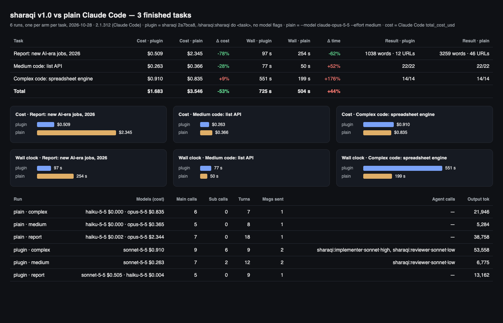
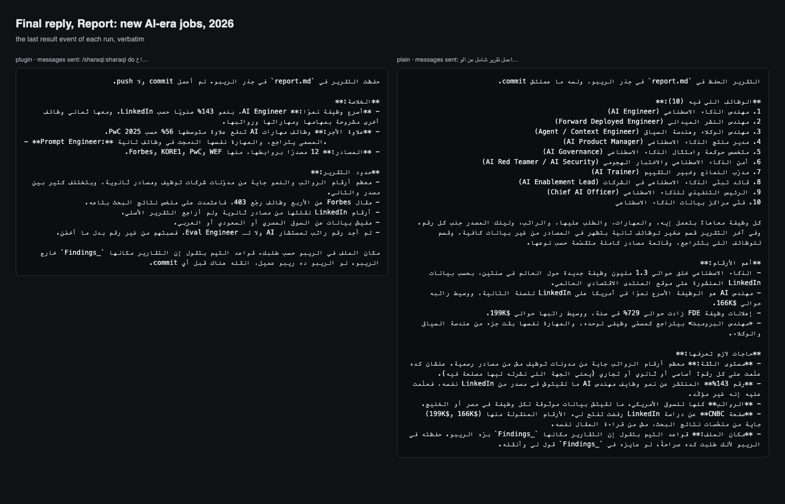
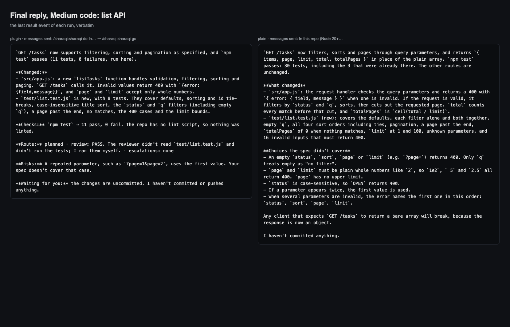
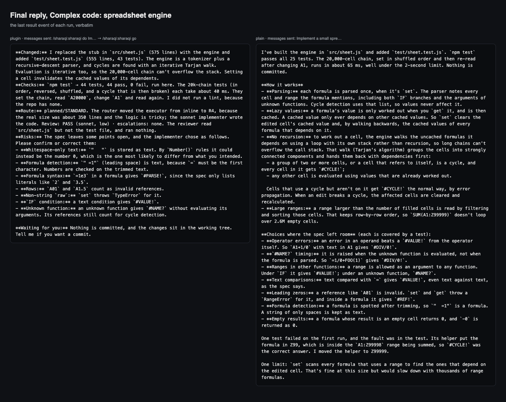
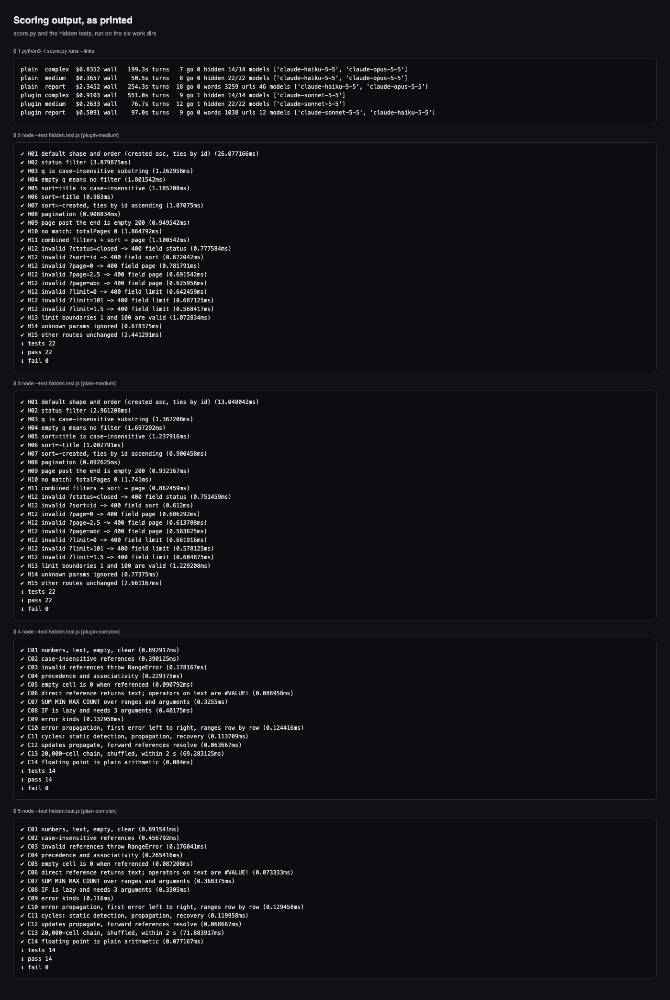

# End-to-end: three finished tasks, sharaqi v1.0 vs plain Claude Code

2026-10-28 · Claude Code 2.1.312 · sharaqi at `2a7bca8` (v1.0.0-exp) · six paid runs, one per
arm per task · total spend $5.29 (the six runs plus a $0.06 probe).



## Result in one table

| Task | Plugin cost | Plain cost | Δ cost | Plugin time | Plain time | Δ time | Correctness |
|---|---:|---:|---:|---:|---:|---:|---|
| Report: new AI-era jobs, 2026 | **$0.509** | $2.345 | **−78%** | **97 s** | 254 s | **−62%** | not comparable: see below |
| Medium code: list API | **$0.263** | $0.366 | **−28%** | 77 s | **51 s** | +52% | hidden 22/22 · 22/22 |
| Complex code: spreadsheet engine | $0.910 | **$0.835** | +9% | 551 s | **199 s** | +176% | hidden 14/14 · 14/14 |
| **All three** | **$1.683** | $3.546 | **−53%** | 725 s | **504 s** | +44% | |
| Code tasks only | **$1.174** | $1.201 | −2% | 628 s | **250 s** | +151% | 36/36 · 36/36 |

Savings in dollars: $1.86 over the three tasks, of which $1.84 is the report task. On the two
code tasks the plugin saved $0.03 and took 6.3 minutes longer.

**Read it this way:** the plugin was much cheaper on the research-and-writing task, slightly
cheaper on the medium code task, and slightly more expensive on the complex one. Plain
Claude Code was faster on both code tasks, by a lot on the complex one. Both arms passed
every hidden test.

## Setup

| | Plugin arm | Plain arm |
|---|---|---|
| Prompt | `/sharaqi:sharaqi do <task>` | `<task>`, the same text |
| Model flags | none (skill frontmatter: `model: sonnet`, `effort: medium`) | `--model claude-opus-5-5 --effort medium` |
| Plugin | `--plugin-dir` = `git archive 2a7bca8` | none |
| Plan approval | the driver sent `/sharaqi:sharaqi go` when a plan waited | — |

Identical in both arms: one live `claude -p` process with stream-json input and output; a
fresh git repo copied from `fixtures/<task>`; `acceptEdits`; the same tool list (`Read Glob
Grep Edit Write Agent Bash WebSearch WebFetch TodoWrite`); a $15 budget; a 30-minute limit;
the installed copy of sharaqi disabled; `SHARAQI_BENCHMARK=1 SHARAQI_CONTEXT_WINDOW=1000000`
(only the plugin reads them).

Cost is Claude Code's own `total_cost_usd` from the last result event. It is cumulative per
session, and it equals the sum of the per-model `costUSD`, which `score.py` checks. Wall
time is measured by the driver from the first message to the process exit.

The tasks, word for word: [tasks/](tasks/). Code tasks were scored by hidden acceptance
tests the runs never saw ([hidden/](hidden/)); both test files pass 22/22 and 14/14 against
the reference implementations in [reference/](reference/), so the tests themselves are
checked.

Scripts: [drive.py](drive.py) (one paid run) · [score.py](score.py) (free scoring,
`--links` checks every URL) · [render.py](render.py) (the screenshot pages; every number
on them is read from the run data).

## Per task

### 1. Report: new jobs of the AI era, 2026 (no code)

| | Plugin | Plain |
|---|---:|---:|
| Cost | **$0.509** | $2.345 |
| Wall · API time | **97 s · 128 s** | 254 s · 393 s |
| Route | `noncoding · direct`, no plan, no review | — |
| Models (cost) | Sonnet $0.505 · Haiku $0.004 | Opus $2.344 · Haiku $0.002 |
| Turns · model calls | 9 · 5 | 18 · 7 |
| Web searches · fetches | 4 · 2 | 13 · 2 |
| Output tokens | 13,162 | 38,758 |
| Words · lines | 1,038 · 103 | 3,259 · 307 |
| Jobs covered | 9 sections | 10 sections, plus "other roles" and "declining roles" |
| Tables | 1 | 2 (incl. a summary table) |
| Salary/demand mentions | 35 | 112 |
| URLs · distinct domains | 12 · 9 | 46 · 38 |
| Links that answer (curl, 2xx/3xx) | 5 | 41 |
| Blocked (403/429, bot-blocking) | 7 (WEF, Forbes, PwC, Axios) | 4 (WEF, Glocomms) |
| Dead (404) | 0 | 1 (99aipro.com) |

The plugin's report cost 78% less and arrived in 62% less time, but it is a third of the
length, with a quarter of the sources. Per 1,000 words the plugin cost $0.49 against $0.72;
per link that answers, $0.10 against $0.06. The plain report also added a confidence note
on the figures, a summary table and a section on declining jobs. These are the two reports'
structure, not a quality grade: no human or model judged the content. Both are in
[results-2026-10-28/](results-2026-10-28/).

Where the cost went: the plain arm ran 13 searches on Opus, and their results came back as
179k uncached input tokens at Opus rates. The plugin ran 4 searches on Sonnet.



### 2. Medium code: filter, sort and paginate `GET /tasks`

| | Plugin | Plain |
|---|---:|---:|
| Cost | **$0.263** | $0.366 |
| Wall · API time | 77 s · 75 s | **51 s · 52 s** |
| Route | `planned · STANDARD`, plan approved, review by `reviewer · sonnet · low` | — |
| Messages sent | 2 (`do`, then `go` at 24.5 s) | 1 |
| Models (cost) | Sonnet $0.263 | Opus $0.366 · Haiku $0.0002 |
| Turns · main calls · subagent calls | 12 · 7 · 2 | 8 · 5 · 0 |
| Output tokens | 6,775 | 5,284 |
| Hidden tests | **22/22** | **22/22** |
| Its own tests, re-run | 11/11 | 30/30 |
| Changed | `app.js` +53 −1, `test/list.test.js` +97 | `app.js` +73 −1, `test/list.test.js` +136 |

Same correctness, 28% cheaper, 52% slower. The extra time is the plan step and the
review: the plugin wrote a plan, stopped for approval, then ran a Sonnet reviewer. In this
run the driver approved at once; with a person approving, their reaction time is added.



### 3. Complex code: spreadsheet engine with cycle detection

| | Plugin | Plain |
|---|---:|---:|
| Cost | $0.910 | **$0.835** |
| Wall · API time | 551 s · 547 s | **199 s · 200 s** |
| Route | `planned · STANDARD`; executor moved from inline to R4 `implementer · sonnet · high`; review `reviewer · sonnet · low` | — |
| Messages sent | 2 (`do`, then `go` at 31 s) | 1 |
| Models (cost) | Sonnet $0.910 | Opus $0.835 · Haiku $0.0002 |
| Turns · main calls · subagent calls | 9 · 9 · 6 | 7 · 6 · 0 |
| Output tokens | 53,558 | 21,946 |
| Time in the implementer subagent | 337 s | — |
| Hidden tests | **14/14** | **14/14** |
| Its own tests, re-run | 44/44 | 25/25 |
| Changed | `sheet.js` +568 −3, tests +555 | `sheet.js` +483 −3, tests +255 |
| 20,000-cell chain, hidden test C13 (limit 2 s) | 69 ms | 72 ms |

Same correctness. The plugin cost 9% more and took 2.8× as long. Sonnet wrote 2.4× as many
output tokens as Opus did for the same result, most of them inside the implementer, which
ran at `high` effort for 337 s. The Sonnet reviewer passed the change after reading
`sheet.js`; it did not read the test file or run anything (the session had already run the
tests itself).

Both replies list the spec gaps they had to decide. The plugin's asks the user to confirm
seven of them; the plain one states its choices and notes each has a test.



## Across the three tasks

| | Plugin | Plain |
|---|---:|---:|
| Cost | **$1.683** | $3.546 |
| Wall clock | 725 s | **504 s** |
| Opus spend | **$0** | $3.544 |
| Opus escalations | 0 | — |
| Messages the user had to send | 5 (3 tasks + 2 `go`) | **3** |
| Hidden tests passed | 36/36 | 36/36 |
| Output tokens | 73,495 | 65,988 |

Where the plugin saved: running the session on Sonnet instead of Opus. Where it lost: on
code, Sonnet needed more turns and tokens, and the plan, approval and review steps add wall
time. On the medium task the price gap outweighed the extra tokens; on the complex one it
didn't.

## Scoring output, as printed



## Limits

- **One run per cell.** Six runs show a direction, not a distribution, and say nothing
  about how much cost and time vary between runs of the same task.
- **The two arms of each task ran at the same time.** Both met the same API conditions, but
  that does not remove noise between the tasks.
- **The report was scored by counts only**: words, sources, links that answer, structure.
  Nobody graded its accuracy or usefulness. 403s are sites blocking curl, not dead links.
- **Plan approval was instant.** Real use adds the person's reaction time to the plugin's
  medium and complex runs.
- **The plain arm was Opus at `medium` effort**, as requested. Plain Claude Code on Sonnet
  would be a different and cheaper comparison.
- The hidden tests check behaviour, not code quality. No one reviewed either diff by hand.

## Reproduce

```bash
cd benchmarks/e2e
git -C ../.. archive 2a7bca8 | (mkdir -p runs/plugin && tar -x -C runs/plugin)
for t in report medium complex; do
  python3 -I drive.py plugin $t runs & python3 -I drive.py plain $t runs; wait
done
python3 -I score.py runs --links
python3 -I render.py runs runs/pages
```

Raw records: [results-2026-10-28/](results-2026-10-28/) holds, for each run, `run.json`
(the messages sent and every result event), the full stream (`stream.jsonl.gz`), the
change as `changes.diff`, the sharaqi hook events and, for the report task, `report.md`.
